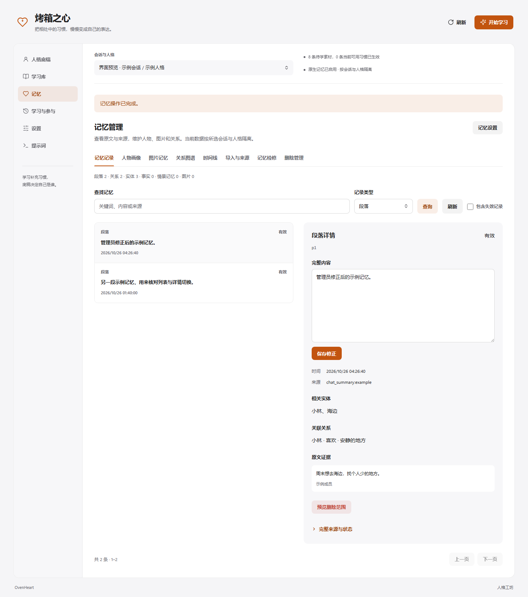

<div align="center">


# 烤箱之心 · OvenHeart

**把相处中的习惯，慢慢变成自己的表达。**

AstrBot 的人格学习、聊天规划与原生记忆插件。<br>
从真实对话积累习惯，记住共同经历，由你管理它们如何生效。

[](https://github.com/AstrBotDevs/AstrBot)
[](CHANGELOG.md)
[](LICENSE)

[快速开始](#快速开始) · [记忆管理](#记忆管理) · [中文指南](docs/zh/README.md) · [English](docs/en/README.md) · [更新记录](CHANGELOG.md)

</div>

---

烤箱之心把 [MaiBot](https://github.com/Mai-with-u/MaiBot) 的部分聊天与记忆机制接入 AstrBot：从群成员的发言中学习表达和本地词汇，在聊天中规划接话、等待或结束参与，并积累有来源的经历、人物与图片记忆。

你可以先审核每条习惯，再决定是否应用；也可以查看、修正、回滚或删除记忆。消息收发、原有人格、模型提供商、工具和权限继续由 AstrBot 承接，管理入口统一放在插件的 **人格工坊** 中。

## 能做什么

| 能力 | 使用方式 |
| --- | --- |
| 人格与习惯学习 | 学习人格倾向、表达方式、群聊词汇与行为策略；每条保留聊天证据，默认人工审核 |
| 聊天规划 | 持续 Planner 支持工具查询、回复结果反馈、等待与结束参与；群聊自主参与默认关闭 |
| 原生记忆 | 基于 A_memorix 保存段落、实体、关系、事实和情景；支持文字、图谱与配置嵌入后的向量检索 |
| 人物与图片 | 整理人物信息和近期经历，保留图片来源、描述及人工观察；可配置多模态嵌入检索相似图片 |
| 表情与回复节奏 | 从当前会话候选中选择表情，按语义分段，并跟踪真实发送结果 |
| 学习库 | 按类别、状态、自检结论筛选，查看证据并批量审核、编辑或停用 |
| 记忆控制台 | 按 MaiBot 的八页结构浏览和维护记忆，支持原版记忆包导入导出 |
| 原生 Panel | 人格预览、分组设置、提示词与运行记录，跟随宿主深浅主题并适配手机 |

学习通过检索与提示词生效，不训练模型权重。模型置信度、自检结论与人工审核分别展示，方便核对证据。

<details>
<summary><strong>查看记忆控制台</strong> · 示例数据，非真实聊天记录</summary>



截图为 0.68.0 本地界面预览，使用虚构会话与示例记忆。

</details>

## 快速开始

### 1. 安装并打开工坊

需要 **AstrBot ≥ 4.29.1、< 5**，当前适配 **QQ / OneBot v11（aiocqhttp）**。先在 AstrBot 配置可用的聊天模型，再从插件管理通过链接安装：

```text
https://github.com/huntersxy/astrbot_plugin_ovenheart
```

也可在 AstrBot 根目录手动安装：

```bash
git clone --branch main https://github.com/huntersxy/astrbot_plugin_ovenheart.git data/plugins/astrbot_plugin_ovenheart
```

安装或更新后重载插件，打开插件卡片中的 **人格工坊**。页面复用 AstrBot 登录与鉴权，无需另开服务或端口。

### 2. 设定人格与学习范围

- **人格底稿**：填写身份补充、表达基调与行为边界，AstrBot 原有人格继续生效。
- **设置 → 学习与生效**：选择学习对象、黑名单、素材节奏与审核方式。默认每积累至少 **12 条**合格素材后后台学习。
- **学习库**：核对原文和自检结果，再批准希望应用的习惯；也可以手动点击“开始学习”。

### 3. 按需启用聊天与记忆能力

- **设置 → 群聊参与**：配置名字唤醒、参与模式、决策模型及自主工具名单；可先用“仅观察”查看决策。
- **记忆 → 记忆设置**：调整通用与图片记忆、经历整理和人物画像。原生记忆无需安装 LivingMemory。
- **设置 → 表达与检索**：调整表情、回复节奏、习惯召回与上下文预算。

模型提供商和 Jev 连接在 AstrBot 原生配置中管理；工坊填写已配置的提供商 ID。生成示例、学习、自动整理和部分检索会使用相应模型服务。

## 记忆管理

选择具体会话与人格，在 **记忆** 页面进入对应管理区：

| 页面 | 可用操作 |
| --- | --- |
| 记忆记录 | 按段落、实体、关系、事实、情景检索；查看全文、来源、原文证据和有效状态 |
| 人物画像 | 查看画像，设置人工覆盖与别名 |
| 图片记忆 | 查看原图预览、消息来源和观察，补充人工观察或移除图片引用 |
| 关系图谱 | 查看实体关联，定位关系并新增、重命名或维护相关记录 |
| 时间线 | 按时间范围查看记忆、情景、修正与删除记录 |
| 导入与来源 | 导入文字、TXT 或 Markdown，查看入库来源，导入导出原版 `.amembundle` 记忆包 |
| 记忆检修 | 强化、冻结或保护关系，查看情景、反馈与修正历史，回滚已执行的修正 |
| 删除管理 | 查看删除操作并恢复；删除前先在记录或来源详情预览影响范围 |

普通浏览直接只读实际记忆库，不启动嵌入请求。管理写入与聊天共用原生 SDK 和写锁；正文已恢复而索引尚未恢复时，会明确提示部分完成状态。记忆包的面板文件上限为 **16 MB**。

曾使用官方 LivingMemory 时，可在 **记忆 → 记忆设置 → 旧库迁入** 预览并迁移有效内容。导入保留完整旧库备份、来源与有效期，重复导入会跳过已映射内容；确认迁入完成后可停用旧插件。联动适配位于烤箱之心，第三方插件源码保持原版。

## 默认行为与数据边界

- 新习惯默认需要人工审核；自主群聊参与、名字唤醒默认关闭。自主工具默认为空白名单，仅文字回复。
- 人格底稿及人格、表达、行为习惯默认共用，可开启会话隔离；**群聊词汇和原生记忆按来源会话与人格隔离**。
- 学习黑名单停止对应来源的采集与学习，已有数据保留；可在管理页面按需停用或删除。
- 原始素材默认保留 **14 天**，每个来源会话与人格最多 **300 条**；这不代表习惯、记忆、证据或备份同步删除。
- 学习和整理可能将相关聊天片段发送给已配置的模型服务。Debug 会包含聊天与注入内容，共享前请脱敏。
- 升级前备份插件配置与 `data/plugin_data/astrbot_plugin_ovenheart/`。涉及删除或迁移时，先核对会话与操作范围。

当前主要使用 AstrBot 本地 Agent 路径；其他平台和第三方运行器的支持取决于各自实现。上下文模式、缓存、Jev 与排查说明见[中文指南](docs/zh/README.md)。

## 文档与贡献

[中文使用指南](docs/zh/README.md) · [English guide](docs/en/README.md) · [更新记录](CHANGELOG.md) · [问题反馈](https://github.com/huntersxy/astrbot_plugin_ovenheart/issues)

反馈问题时请附 AstrBot / 插件版本、平台、复现步骤和脱敏日志，不要上传密钥、数据库或真实群聊导出。

开发环境使用兼容的相邻 AstrBot 源码；按改动范围执行检查：

```bash
uv sync --python 3.12
uv pip install -e ../AstrBot
uv run --no-sync ruff check .
node --test tests/test_frontend.mjs tests/test_panel_loading.mjs
uv run --no-sync python scripts/package.py
```

记忆管理的原生 SDK 定向验证：`uv run --no-sync pytest tests/test_memory_panel.py -q`。

## 致谢与许可

运行于 [AstrBot](https://github.com/AstrBotDevs/AstrBot)，聊天与记忆机制参考并移植自 [MaiBot](https://github.com/Mai-with-u/MaiBot)，可兼容[官方 LivingMemory](https://github.com/lxfight-s-Astrbot-Plugins/astrbot_plugin_livingmemory)。

本仓库采用 [AGPL-3.0-or-later](LICENSE)。移植代码的来源、修改说明与原许可证保留在 [MaiBot 移植说明](vendor/maibot/NOTICE.md)及 [A_memorix 移植说明](vendor/maibot/amemorix/NOTICE.md)中。机制适配与完整聊天效果对齐的验收范围见[设计记录](docs/design/maibot-parity.md)。
