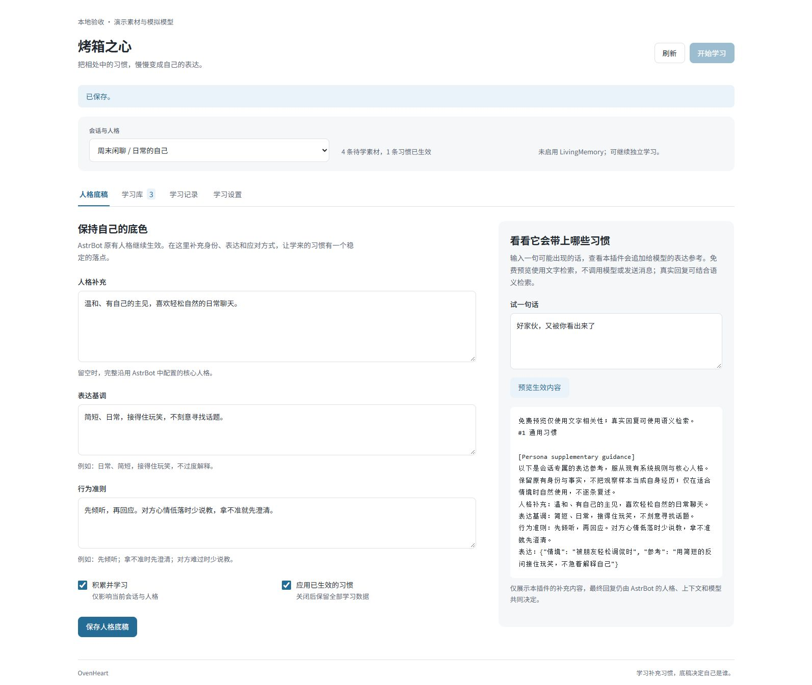

# OvenHeart workshop guide

## Native mention and bot-quote integration (0.52)

The plugin enhances native requests without patching AstrBot. Native @, bot
quotes, private messages and commands keep host wake handling. Group direct
requests share frozen sender/message/quote context with habit selection and final
generation, plus at most twelve existing same-scope turns from the preceding ten
minutes, with 300-character body excerpts. No window means no invented group
history. Explicit wakes keep one native agent invocation without autonomous
planner, confidence/cooldown checks or autonomous tool restrictions. Host access
and service controls remain; disabling plugin application leaves native replies.

Retain the host-prepared prompt, multimodal data, history, tools, conversation and
runner. LivingMemory keeps its own native hooks, without a duplicate memory chain.
Application may create a scope while learning is paused or the input is quote/
media-only; this does not manufacture learning evidence. Existing workshop entries
"自主参与：系统提示" and "自主参与：临时上下文" retain their names and now also
serve group direct replies. Custom text remains; avoid hardcoding members or
requiring another participation decision for direct wakes. Both direct snippets
are temporary tail content, preserving stable system/history prefixes. Direct
`expression_intent` is empty; no extra expression-planning model is introduced.

Native direct streaming settings are restored, superseding 0.51.1 full buffering.
The host skips decoration hooks for streaming results. Wrap only this OneBot
event's adapter call and lazily recognize a separated leading address, flushing
undecidable pending text beyond 72 characters. Do not buffer the full answer.
Keep traced iteration, native fallback flags, control/reasoning/audio/media chunks
and the original adapter. Restore its method before consuming generation so tool/
plugin streams cannot recurse; close guard/source iterators on completion or
cancellation. Actual delivery/segmentation/audio capability remains host/platform
dependent. Buffered direct replies retain existing correction/quote behavior;
autonomous replies retain their buffered stale-plan checks.

Native history still stores the model result; provider output and already sent
content are not rewritten. Only separated leading addresses are corrected, not
arbitrary inline semantics or existing real At components. Debug direct routes
are `at`, `quote`, `name`, `native`; streaming correction uses
`reply_addressee.path=direct_stream`. Focused checks exercise native wake/process/
respond stages with simulated agents/adapters. Real QQ delivery, production tool
execution, live audio and other runner/platform combinations remain unverified.

## Default participation preferences (0.51.2)

The default planner now considers playful jealousy when an established close
member interacts affectionately with another AI, more active responses to genuine
self-mentions, and suitable meme/banter participation. Relationships come from
existing identity/context, and names from the host persona and configured bot
aliases. No specific names or automatic name fragments are shipped. Configured
aliases are visible to the planner even when immediate name-triggered replies are
disabled; these preferences do not bypass mode, cooldown or admission gates.

The actual confidence threshold is provided: choose reply when there is a concrete
response direction and sufficient genuine confidence, otherwise wait for expected
information or observe. Custom planner text remains unchanged on upgrade; restore
its default in the workshop or merge the preferences manually. Optional template
placeholders `{{bot_names}}` and `{{reply_threshold}}` and their structured context
fields expose existing settings without a new model stage or configuration field.

## Current addressee and learned mention actions (0.51.1)

A model may copy an old plain-text `@name` prefix into an answer to another
member. Direct group requests now carry a temporary snapshot of the actual
incoming sender/message; autonomous replies retain their validated planner
target. Before delivery, separated leading model-written address prefixes bind
to that target as real At components, without duplicating its existing mention.
Enabled native quote decoration is preserved. Inline mentions, literal code and
email examples, and existing structured At components retain their original
handling. This does not infer a new planner target from answer semantics.

For permitted OneBot QQ group direct/name-triggered replies with application
enabled, buffering is selected before the local agent reads its streaming flag.
The answer is generated in full, corrected and delivered, without another wake
or model request. Incoming identity, history and stable system prefixes remain;
target context is temporary tail content. Other platforms and send paths without
normal hooks still require live verification.

Learning, review, contextual selection and application prompts distinguish
responding when addressed from copying delivery actions into language/behavior
habits. Extraction/review and final requests carry fixed delivery rules even
when custom template text is retained. Existing habits and manual decisions are
not purged. Technical email/decorator/symbol discussion is not automatically a
mention action. Prompt compliance is not guaranteed; leading-address correction
is a separate delivery safeguard, not general semantic interpretation.

Debug `direct_reply_target` records temporary direct-target context;
`reply_addressee` records the path, actual target, copied prefixes and before/after
mentions. Use these to distinguish a copied prefix from a wrong planner target.
Focused native-SDK checks use simulated providers; real QQ delivery remains
unverified.

## Bounded periodic document-index maintenance (0.51)

Keep existing startup/write/review-triggered warm passes. The existing 15-second
scheduler additionally visits one native scope at most once per minute, with at
most 64 documents and the existing `min(2, retrieval_timeout)` vector-stage budget.
Cycle through stable scope IDs using one cursor, without an unbounded scope map.
Advance cursor/deadline before attempting, including failure/denial. Startup and
write-triggered passes are separate; this is not a global one-pass-per-minute cap.

Require enabled application, a configured embedding provider and non-lexical
retrieval. Skip known learning/warming/vector-lock/selector/rerank/participation
activity. Filter disabled application profiles and the session allowlist, then
reuse current-setting and native host/session/plugin permission checks. Existing
active habits may warm while extraction is paused. Disable application, use
lexical mode or clear the embedding provider to stop this maintenance. The plugin
does not track every final-generation activity in the host; this is not proof of
global idleness.

Reuse persisted content-addressed vectors; later passes advance beyond the first
batch and fully cached passes make no document requests. Shared non-jargon and
source-local vocabulary keep existing ownership. Add no query embeddings, chat
calls, source consumption, exposure, schema or setting. This may move configured
document-service usage ahead of replies. Budget, permissions, errors and scope
count can delay coverage; on-demand indexing remains available. Do not assume
complete coverage time, production latency or cost improvement.

Two scheduler/native-SQLite cases and the existing committed-learning failure
case pass with simulated time/providers: 130 documents progress through 64/64/2
without duplicate document calls after completion, query/chat calls or source
consumption. Confirm rotation, allowlist and busy-selector skips. Existing debug
`embedding_warmup` records bounded pass results/error types/timing. Real workload
and service usage remain unverified.

## Human-body terms before quote-only definitions (0.50.1)

After nesting resolution and ordinary scoring, stably prioritize local terms
mentioned in the actual human target body over quote-only matches, then apply
count limits. Keep scoring order within each source class. With one slot, a
strongly rated quote definition cannot displace the word actually asked about;
prioritization happens before truncation.

The optional internal focus comes from the actual autonomous target or direct
incoming event, never a rewritten provider prompt, history, adjacent additions or
planner intent. If the body only asks "what does this mean?", quote-only recall
still works. Callers without explicit focus retain existing behavior. Keep
semantic selection, cache prefixes, scopes/status checks, count/character budgets,
native prompt, target/message IDs and temporary delivery. Add no model stage or
configuration switch.

Debug `literal_focus_ids` lists retained body matches; mixed-source retrieval
messages explain priority. Two focused simulated-provider checks cover native
SDK injection, a stronger quote match, selector bias, quote-only anaphora and call
counts. Production response quality remains unverified.

## Full local terms before nested fragments (0.50)

Resolve nesting by actual normalized-text match spans before the existing literal
definition count limit. Process active matching terms longest first. Suppress a
short term only when every valid occurrence is fully contained in a strictly
longer matching term; another independent occurrence preserves it. Equal terms
and partial overlap do not shadow one another. Disabled or absent longer entries
do not remove active short terms. This prevents frequent short fragments from
outscoring the actual full term under a small output limit.

Reuse width/case compatibility and ASCII word boundaries: `LUX` still does not
match `deluxe`. Remove fully shadowed IDs even from ordinary contextual selection,
then prioritize surviving literal definitions with existing scores/budgets. Keep
stored definitions/decisions, native scope eligibility, status rechecks, actual
target/quote input, selector cache/prefixes and all call budgets. History,
same-member additions and planner intent do not force literal definitions.

Debug `shadowed_jargon_ids` and retrieval messages explain exclusions. Mechanical
nesting is not general segmentation, character analysis or semantic
disambiguation; the final model must still interpret the task. Two focused checks
and both existing empty/invalid-selector definition paths pass with simulated
models. Production response quality remains unverified.

## Evidence-linked terminal punctuation (0.49)

Existing `language_features` still summarizes each eligible speaker separately,
requiring four batch samples for that speaker. Add `terminal_punctuation`: up to
six literal suffix patterns, each with `marks`, message count and original
`evidence_ids`. Order by descending frequency then text, with remaining pattern
counts in `other_terminal_punctuation_messages`. Do not aggregate speakers or
derive these statistics from quotes, non-target context, self turns or blocked
sources. Statistics do not automatically become habits or style samples.

Recognize literal trailing English/Chinese commas, periods, question/exclamation
marks, semicolons, colons, plus ellipses, tildes and em dashes after trailing
whitespace. Do not normalize width, remove closing quotes or classify all emoji.
`no_terminal_punctuation` provides IDs/counts without those recognized suffixes;
it does not imply an absence of all symbols, tone or emotion. Put IDs at the
1,200-character capture boundary or with more than 12 terminal marks in
`terminal_summary_omitted_ids`; do not mistake truncation for omitted punctuation.
Keep the original observations available.

The default prompt treats summaries as descriptive aids, not independent evidence,
personality/emotion inference or mandatory punctuation. Original evidence IDs,
literal sample validation, review, manual locks and activation policy still apply.
The vocabulary stage's structured feature list remains empty. Existing custom
learning templates retain their text and may access the fields through
`{{language_features}}`. Add no model stage, setting or schema. Two focused native
SDK checks pass with simulated models; production learning quality/naturalness
remain unverified.

## Same-member additions around the actual target (0.48)

After autonomous admission, inspect the target's adjacent turns within the same
20 messages actually offered to the planner. Stop each direction at another
member, a self turn or more than 30 seconds from the target. Keep the nearest four
in chronological order with original sequence/message IDs, member and capture
time. Text is bounded to 300 characters, retaining head/tail when necessary.
`reply_context` preserves these additions even outside the existing latest-12
final context. Capture times define this context heuristic, not actual send or
reply speed.

The final temporary context may use additions, negation and corrections to
interpret the target. Habit recall/selection receives up to 120 head/tail
characters per addition within its existing 2,400-character query budget. Keep
the actual target, native prompt, quote/mention and LivingMemory source binding.
Adjacency does not prove a shared topic, merge messages or create evidence.
Literal vocabulary input still uses only the target and explicit quote; words
from additions are not forcibly pinned. Direct-wake replies do not infer history
authors through this feature.

No model call, switch, persistent source copy or schema is added. Cached delivery
keeps additions in the temporary tail, excluded from native history. Custom
participation-context templates may use `{{reply_context}}`; existing template
text remains and the structured payload still includes the field. Debug
`participation_reply_context` lists target/addition sequences; retrieval and full
injection diagnostics contain the bounded text. Two native-SDK checks and the
existing style-intent path pass with simulated models. Production understanding,
naturalness and delivery remain unverified.

## Visible autonomous reply targets (0.47.1)

The participation window retains at most 30 messages, while a planner request
actually offers the latest 20. Validate `target_sequence` against those same 20:
a guessed sequence from an unseen retained turn cannot become the reply, quote,
mention or memory-source binding target. Earlier actually offered messages remain
valid. Older custom prompts omitting a target still default to the latest visible
non-self message. Invalid targets use the existing error/observation path without
reply generation or another correction call.

One focused native-SDK case with 30 simulated messages confirms rejection of an
unoffered target and acceptance/decoration of the oldest offered one. Real QQ
delivery and conversational quality remain unverified.

## Less redundant expression candidates (0.47)

For contextual replies with successful vector retrieval and more than 24 eligible
candidates, consider at most 64 ranked habits before offering at most 24. Use the
current validated document vectors for relevance-first MMR, similar to MaiBot:
0.85 normalized original relevance minus 0.15 maximum similarity to previously
chosen expressions. Preserve the strongest indexed expression. Only indexed
expression slots in the original top 24 can change; personality, behavior,
vocabulary and unindexed entries keep their original slots. Restore original
relevance order among chosen expressions before existing rerank/selection.

Do not add embedding, query or chat calls, persistent vector copies, settings or
schema. Bound dot products in a worker thread. Lexical fallback is appended after
diversification; failed vectors, small pools, hybrid/lexical retrieval, free
preview, planner and learning-reference recall retain their behavior. Existing
query/rerank/selector caches remain usable; identical inputs give deterministic
candidate sets.

Retrieval messages explain promoted candidates; debug
`expression_candidate_promotions` lists newly offered IDs. These are choices for
the subsequent model, not adoption, approval or guaranteed wording diversity.
Existing applicability selection, permissions, active-state checks, literal local
vocabulary priority and injection budgets still apply. Four focused checks pass
with simulated vectors/models, covering crowded alternatives, strong relevance,
fixed slots, cache reuse and existing fallback/prefix behavior. Production
quality, latency and billing remain unverified.

## Exact contextual-choice cache (0.46)

Completed validated selector IDs, including an intentional empty choice, can be
reused for 60 seconds in memory. Keep at most 64 entries with access-order
eviction; hits do not renew expiry and later requests purge expired entries.
Fingerprint the effective habit scope, full actual request (identity, candidates/
samples, limit, recent-expression hint, style intent, conversation and template)
and native provider instance/model/configuration. Isolated scopes cannot share;
shared mode still requires matching actual candidates, persona and conversation.

Entries hold a digest, native provider reference and IDs, not copied request/config
text or raw completions. Secrets are not emitted in cache diagnostics. Current
metadata is rebuilt rather than cached trait copies; fields not seen by the
selector can change without invalidating otherwise identical inputs. Changed
candidate state/text/samples or actual request recomputes. Unresolvable providers
or fingerprint failures retain ordinary calls. Provider/configuration replacement
before completion prevents stale publication. Invalid/failed output and requests
cancelled during generation do not seed the cache; in-flight work is not shared.

Exact hits precede the two-remote-request capacity check. Misses retain existing
timeouts/capacity. Permission/profile/persona/active-state rechecks, local literal
vocabulary and final reply generation remain. Vector/rerank recall may still use
services through their own caches/budgets; a hit does not promise zero other calls,
adoption, delivery or approval. Free preview does not invoke the selector.

Diagnostic `selector_cache_hit` and retrieval messages identify reuse. No switch
or database migration is introduced; plugin reload clears entries. Four focused
cache cases and three existing selection/prefix checks pass with simulated
providers. Provider KV hits, production latency and billing remain unverified.

## Selective sample review (0.44)

In Library details, mark individual samples with the removal checkbox, then Save
or use an existing review action such as Approve. Selection alone does not write;
uncheck to undo the draft. Existing dirty-state navigation/refresh protection
applies. The rule, unselected samples and evidence stay unchanged. Actual wording
edits still clear all old samples, as explained beside the controls.

Validate exact sample text in the owning scope, not a potentially stale array
position. Missing/changed samples reject the entire removal/status/edit operation
without partial approval. Existing snapshots retain the earlier state and can
restore samples. Removal marks the entry manually locked, preventing subsequent
reinforcement from readding samples to that entry. Existing content-digest caches,
prewarming and preview checks recognize the change without another model call or
database column.

Removal manages this reference only: evidence, snapshots and chat history remain.
It is not a global word ban or a guarantee about generated wording from other
habits/persona/history/model knowledge. Three native API/SQLite checks and a
bounded desktop selection/unsaved-navigation/save interaction pass with synthetic
data. Mobile and production effects remain unverified. The [desktop result](../assets/expression-review-v0.44-desktop.png)
shows the remaining sample and unchanged rule.

## Grouped sampling for multiple explicit targets (0.43)

Since 0.45, same-group ties prefer the least recently successfully processed
speaker in the native scope, then original message order. Targets omitted by a
capacity-limited batch move ahead in later successful batches. Retain scheduler
order separately from chat chronology so earlier arrivals cannot reclaim priority
when committing. Advance atomically with successful source consumption, including
successful empty extraction; failures/cancellation/retries do not advance it.
All-speaker and single-target selection remain FIFO.

The additive `learning_sender_state` table stores only native scope, sender ID,
processing order and update time, never text, evidence, confidence or feedback.
Private scheduling positions do not enter model payloads. Legacy libraries start
empty without inferring history or rewriting IDs. State survives restart, expires
under raw-material retention and clears with that scope's raw materials. Habit
snapshot restore does not rewind operational processing; global habit sharing does
not share scheduling records. Four SQLite checks and one native regression cover
rotation/restart, failure, scoping, cleanup and prompt exclusion. Capacity, source
expiry/caps, evidence and activation rules still apply without extra model calls;
production quality remains unverified.

With two or more explicitly selected learning targets, select oldest eligible
messages in per-speaker groups of `min_evidence`: consider each speaker's first
group before second groups, with original message order breaking same-group ties.
Restore chronological order before extraction, preserving source/quote links.
For 40 earlier messages from A and four later messages from B, size eight and
minimum evidence two can select four from each; language statistics stay separate.

All-speaker and single-target sampling retain FIFO. Apply blacklists before
grouping, keep native scope boundaries, and consume only the actual successful
batch. Unselected rows remain pending under existing retention/caps. Trigger,
batch-size, activation and review settings stay unchanged, without another model
call, switch or schema migration.

Coverage remains capacity-limited, not a guarantee of per-speaker learned output
or strict cross-batch rotation. If target count times minimum evidence exceeds
batch capacity, increase batch size or select fewer targets to fit full first
groups. Unstable language still need not produce a trait. Four temporary-SQLite
and simulated-native checks cover group sizes, defaults/blacklist, exact
consumption and end-to-end speaker statistics. Production quality is unverified.

## Soft rotation among comparable expressions (0.42)

Lexical, hybrid and rerank modes now use existing native-session recent expression
IDs from the last three send-stage applications within ten minutes. Global habit
sharing does not share this exposure record across native sessions. Only expression
positions within the existing at-most-24 pool can swap. A fresh candidate must be
within five percent of the current ranking score, with absolute tolerance 0.005
near zero. Without rerank, lexical and cosine scores must also be no more than
0.05 lower. Identical rule/sample text under another ID is not fresh wording.

Personality, behavior and jargon do not rotate; literal local vocabulary remains
prioritized. Missing comparable alternatives or an all-recent pool retains normal
ordering. Contextual mode preserves its existing recent-ID prompt hint and explicit
model choices. Original scores, application count and character limits remain;
when several expressions fit they may still be supplied together. This is a soft
preference, not a ban on repetition or a guarantee of varied generated wording.

Rotation follows remote rerank, preserving its cache inputs and query-vector keys.
Cached delivery keeps changing references temporary. No extra model calls, random
sampling, settings or persisted feedback are introduced. Diagnostic
`expression_rotation` IDs and reasons identify promoted references; exposure is
not adoption, delivery or approval. Four focused tests cover recent inputs,
identical/unrelated wording, literal vocabulary and near/far rerank scores with
cache reuse. Production phrasing diversity remains unverified.

## Long-term background for participation (0.41)

The existing memory integration switch now lets admitted participation planning
reference LivingMemory background in the same planner request. Query recent human
text and allowed quotes from the final six window records, within the existing
500-character query budget. Include at most `min(memory_top_k, 3)` excerpts of
300 characters. `memory_context.for_sequences` links query inputs, not ownership:
background cannot establish another member's identity, override current messages,
become bot autobiography or force participation.

Habit recall runs first; memory gets only the remaining `retrieval_timeout`
budget. Unavailable/disabled services, failures, expiry and timeouts retain recent
message/habit planning. No extra planner-chat stage is introduced, but memory
search may invoke LivingMemory's configured services. A waited second decision
may search again under its own shared budget. Bounded repeated queries may help
service caching without a hit-rate or billing guarantee.

Personal `livingmemory:user:*` recall is deferred until the reply target is known;
existing native final-reply source binding still handles it. Other scopes follow
LivingMemory access, persona and session/global/legacy sharing exactly, including
its explicitly configured global/unfiltered ranges. OvenHeart's global habit
mode does not widen those policies.

After search, recheck plugin readiness, session plugin access, allow rules, scope,
persona-filtering mode and plugin/engine identity. Changed results are discarded;
this also protects existing learning recall. Planning rechecks OvenHeart's own
policy/profile/persona and remains cancellable by new input. The excerpt array is request context and is not directly written into materials,
evidence, habits or decision history. Model-generated reasons/intents retain their
existing persistence and may summarize that background.
Opt-in `planner_memory` and existing request diagnostics expose context/status;
errors log types only.

Editable planner templates may use `{{memory}}`; structured requests always carry
`memory_context` and customized bodies are preserved. The switch covers learning
and planning reference, not LivingMemory's separate native reply switch. Four
focused planning scenarios and the existing bridge-policy case pass with the real
policy module and a simulated engine. Production quality/latency remain unverified.

## Conversation continuity after direct streaming (0.40)

Version 0.40.1 also fixes direct answers that yield multiple native send-stage
callbacks for one event. Previously only the first part advanced the consumed
position, preventing follow-up eligibility after the last part. An event-local,
scope-bound room marker now lets uninterrupted parts continue the same answer.
Intervening input permanently prevents late parts from reclaiming ownership or
consuming newer human messages. Existing context bounds, planner judgment, same-
member checks, quota and configuration remain; there is no extra model call.
Host paths that report all segments in one callback retain their existing path.
The three-part failure was reproduced before the fix; two direct checks and one
existing autonomous-segment check pass with simulated events, not QQ transport.

Direct streaming skips the host after-send hook, but the current native Agent
normally emits final text in `STREAMING_FINISH` after adapter consumption. This
notice can now invoke existing recording logic. Require a plugin-bound native
model-request scope, the host send-operation flag, an unstopped/permitted event
and unchanged effective persona scope. Duplicate notices for the same result
object are ignored. Intermediate chunks, unbound/unsent results, generation alone
and persona changes cannot create a self record.

Final text uses the existing 1,200-character participation record and addressee.
Same-member continuations may use the configured follow-up opportunity; quota,
permissions, confidence and stale checks remain. Direct streaming settings stay
unchanged; autonomous replies remain buffered for pre-send guards/decorations.
Completed content is neither decorated again nor resent. No extra model call is
introduced.

The notice can also supply existing volatile learning self context, requiring an
eligible human material anchor and current learning/blacklist/profile gates.
Existing five-minute/64-entry/16-context limits apply. Text remains `self=true`,
outside raw materials, evidence and persistent habits. Existing exposure writes
retain their idempotency. A final notice/send flag is not a platform delivery
acknowledgement; partial or altered delivered streams are not reconstructed from
model output. Adapters, Live paths and older hosts without a usable final notice
remain unsupported. Opt-in `streaming_self_context` logs bridge admission, not a
guarantee that every downstream context gate retained text. Seven focused native
SDK simulated cases pass; production QQ streaming remains unverified.

## Grounded expression samples (0.39)

Since 0.39.1, expression entries in `known_traits` also carry old sample text in
`examples`, alongside stable ID/condition/rule/status fields and before dynamic
support statistics. Admission review sees the same text in `merge_target.examples`,
including an empty array for unsampled expressions. Old samples expose no source
metadata and are not current evidence. Reviewed merges atomically recheck target
sample text: sample-only and empty-to-nonempty concurrent changes cancel the stale
result without consuming materials. Metadata-only differences do not invalidate
a text-only judgment. Three native simulated checks cover reinforcement and both
concurrent-change cases, with no additional model stage.

Expressions may retain three short source spans alongside their rule. The existing
extractor can return `examples: [{"evidence_id": 1, "text": "..."}]`. Each span
must be at most 60 characters and literally occur in the first 300 characters of
that candidate's own cited human observation. Duplicates add no evidence count.
Context, quotes, memory and self turns cannot serve as sources. Malformed shapes
use existing repair; fabricated spans fail without consuming materials. Missing
samples remain compatible. Customized prompts are preserved; update their
instructions or restore defaults to request extraction/review of samples.

Existing admission review checks applicability, personal facts, privacy, identity
and tool-instruction concerns alongside the rule. Literal matching proves origin,
not suitability; disabling review omits this model check. Existing lexical,
vector, rerank and contextual selection consider sample text. Its content digest
invalidates affected caches. Final guidance contains text without author/source
metadata, using the existing budget and preferring the abstract rule if samples
do not fit. Cached delivery stays temporary. No extra chat stage is introduced.
Samples are style references, not fixed lines, bot facts or tool permissions.

Library details show samples, source and time; since 0.44, selected samples can be removed with Save or review actions. Approval with unchanged
wording retains them; actual manual edits clear them. Manual locks prevent
replacement. Unlocked reinforcement follows existing activation/confidence gates
and retains the first three distinct samples. Active habits in review mode do not
gain unapproved active samples. Learned wording refinement clears old samples
before considering new ones. Snapshot restore restores samples; legacy snapshots
restore an empty list. Upgrade adds an empty JSON column without historical mining.

Samples/provenance persist with habits and snapshots, like existing evidence
excerpts, independently of raw-material expiry/clearing. Blacklist changes retain
existing habits/samples; operators can disable or edit them. Four focused checks
use temporary SQLite and simulated providers. The [desktop fixture capture](../assets/expression-examples-v0.39-desktop.png)
was inspected; mobile and production style quality remain unverified.

Since 0.38.1, runtime recall reads all scope-eligible compact active records,
and learning reads compact records with their actual states from writable merge
scopes. Neither inherits dashboard detail's latest-1,000 cutoff. Older active
habits and rejection/disable decisions remain eligible as the library grows.
Shared learning still merges shared non-jargon records and source-local jargon;
runtime shared application retains its existing cross-source non-jargon rule.

Evidence bodies, run histories and snapshots are excluded from these reads.
Dashboard detail limits and paginated library browsing stay unchanged. Memory
and ranking cost scale with eligible record count. The 64-document embedding
batch, rerank/selector pools, injection limits and at-most-80 learning references
remain bounded. Eligibility does not guarantee selection or full cold-start
semantic coverage. Three simulated checks cover old cached semantic recall,
rejection-preserving consolidation after 1,000 newer entries, and scope rules.

## Per-reply expression intent (0.38)

Like the local MaiBot expression selector, participation planning can supply an
optional `expression_intent` object with `focus`, `reply_act`, `scene`, `tone`,
`prefer` and `avoid`. Each optional value must be text of at most 80 characters,
with at most 240 characters in total. Unknown fields, invalid types and excess
length follow the existing malformed-plan observation path. Missing intent keeps
legacy completions valid; observation, waiting and low-confidence replies clear
it. List-valued fields from MaiBot's broader protocol are not accepted here.

The same bounded intent informs existing semantic/rerank recall, contextual habit
selection and the final reply. Real messages, explicit current requirements,
identity and permissions take precedence. The recall query stays within 2,400
characters; reserving intent space can shorten its quote tail. Literal jargon
matching still uses the independent human target/quote, never planner wording.
No extra chat call, tool authority, learned evidence, habit or database field is
introduced. Direct wakes retain their existing behavior.

Selector and participation prompt templates expose `{{expression_intent}}`.
Customized bodies are preserved; add the optional output instructions or restore
the planner default to request this information. Cached delivery carries intent
in temporary user content, preserving system-prefix handling without promising
provider cache hits. Changed retrieval inputs use their normal cache keys.
Existing opt-in request/response/injection diagnostics include intent; decision
history retains the original reply goal. Three simulated focused checks pass;
production tone and applicability remain unverified.

## Prewarming active habit vectors (0.37)

Committed learning, manual approval/content edits, snapshot restore and shared
profile startup can schedule a background document-vector pass. It sends only
active habit situation/content to the configured embedding provider, without
reading raw materials/evidence bodies, generating a query embedding or calling
rerank/chat models. Content-addressed scoped vector caches are reused.

Lexical, unconfigured or paused application paths and empty active libraries are
skipped. Native source origins retain allowed-session/plugin-set/session-enable
gates. Only one warm job runs; already busy retrieval and overlapping warm work
are skipped. Started warming shares the existing retrieval lock. Its vector phase
uses `min(2, retrieval_timeout)` seconds and at most 64 missing documents per pass,
without looping over the whole library or adding a setting.

Warming is derived cache work, separate from successful learning/review commits.
Failure, timeout or unloading cannot turn those commits into failures. Existing
on-demand retrieval fills incomplete coverage. A completed pass is not a fully
indexed library: large libraries, edits and skipped jobs can still incur indexing
on the first query. Configured document calls may occur before real replies; no
zero-extra-call, production latency or billing guarantee is made.

Opt-in `embedding_warmup` logs show attempt status, active count, batch cap and
elapsed time; errors expose only their type. Exposure/material/activation state
does not change. Focused checks used simulated providers only.

Since 0.36.1, ID-less arrivals use one cached per-event source identity instead
of learning's sender/second/text fingerprint. Distinct identical messages survive
equal platform and arrival timestamps, while repeated hooks on the same event
deduplicate. Capture, room interruption/planning, send-stage context and target
anchors share this rule. A fallback remains stable if an adapter fills the ID
later.

Real platform IDs retain native redelivery deduplication and existing scope/
evidence boundaries. Fallback identities are not quoteable platform IDs. Memory
anchors still validate native ID, author, text and persona snapshots. Without
a native ID, separate event objects cannot reliably distinguish transport
redelivery from genuine repeated speech; new arrivals are retained. No settings,
database migration or provider calls are added. Real adapter acceptance is
pending access.

## Retaining quote premises for delayed learning (0.36)

Explicit native quote text now accompanies an eligible observation in the plugin
SQLite database, surviving five-minute cache expiry or a restart. This addresses
slow-group/manual batches whose short replies previously lost their premise.
No platform history is fetched and missing historical quotes are not invented.
An additive, idempotent migration preserves existing message IDs, consumption and
deduplication.

**Retention changes:** up to 1,200 quoted characters share the source observation's
`retention_days` (14 days by default), per-scope row cap and clearing/expiry rules.
Quotes are not independent observations or evidence, do not enter habit evidence
snapshots, and retain explicit author/`for_evidence_ids` relationships. Requests
keep the existing 400-character excerpts and sixteen-context limit. Own quoted
text remains `self=true`, never self-learning evidence. Ambient peer text and
send-stage own context retain their original volatile five-minute limits.

Capture and reads enforce the current blacklist; unknown quoted authors are
excluded whenever a blacklist is active. Previously stored raw quote text is not
physically deleted by blocking: clear the source materials or let them expire.
Blocked quotes cannot be reintroduced from stale volatile copies. Eligible human
responders can still be learned without their blocked quote.

Allowed premises also join existing bounded counterpart/learning-memory queries,
without an additional memory call per batch. Native source, jargon, evidence and
review boundaries remain. Settings help now discloses quote retention. Checks use
isolated SQLite and simulated providers; production learning quality is pending.

## Finding existing habits during learning (0.35)

Learning consolidation references now reuse configured embedding/rerank recall,
alongside the latest forty records. This can offer older counterparts when new
evidence uses different wording. Recall does not decide merges: existing
extraction/review, human locks and activation rules remain authoritative.

References retain their actual pending/active/rejected/disabled states and stable
ID ordering. Internal retrieval eligibility never reactivates a record. Entries
and profile are refreshed after recall; changed settings/prompts/profile cancel
the old batch while preserving materials. Candidate scopes remain unchanged.

The 2,400-character recall query allocates an excerpt to every batch source and
keeps head/tail text for long messages. Full observations, language statistics and
evidence counts are unaffected. Contextual mode uses hybrid recall here, without
an extra chat-selector call. Lexical mode makes no embedding/rerank calls.
Configured recall uses existing caches and `retrieval_timeout` before the usual
extraction/review budget; unavailable services retain lexical fallback.

Configuration help now discloses this use. Opt-in `learning_retrieval` diagnostics
show query, mode/fallback and offered IDs, without overwriting runtime reply
retrieval status. Focused checks establish reference availability and the call
path, not correct semantic merges or production dialogue improvements.

## Reusing repeated reranks (0.34.1)

Validated rerank scores can be reused for five minutes, with at most 64 entries
and access-order eviction. Replies, planning and model examples share the
retriever; free lexical previews remain unchanged. No switch is added.

The fingerprint includes effective scope, ordered habit IDs/text, actual query
and non-secret model/endpoint/request options. Provider-instance replacement
clears the cache. Changed inputs or expiry require a new call. Hits rebuild
results from current habit metadata, retaining existing scoped candidate,
disablement and application checks. Shared mode reuses identical actual score
inputs without carrying another conversation's text or local vocabulary.

Only hashed fingerprints, timestamps and ID-to-score mappings are cached in
memory. Queries, candidate text and credentials are not persisted. Failures,
invalid results and cancellations are not cached; late replaced providers cannot
publish into the new provider's cache. Warm hits need no remote capacity or
remaining network budget; misses keep the original two-request and timeout
limits. Pending simultaneous requests are not coalesced.

Retrieval messages disclose reuse, and Debug results expose `rerank_cache_hit`.
Chat selection and final generation still run normally. This local result cache
does not establish chat-provider prefix/KV hits or production billing/latency
improvements; focused checks used simulated providers only.

## Target-aware LivingMemory replies (0.34)

Install OvenHeart 0.34 together with the local LivingMemory build
`2.7.0-beta.3+ovenheart.1`, then reload both plugins. This is an integration build,
not an upstream LivingMemory release. No configuration or data migration is
required. Older LivingMemory builds remain usable with their previous native
event-based behavior.

For an earlier-member autonomous target, OvenHeart retrieves a real native event
from its bounded 128-anchor runtime cache, independently of learning. It checks
message ID/text/sender, origin, effective persona and host permissions before
binding. LivingMemory also checks matching native group session/platform/bot,
human source, ten-minute age and both allowlists. Recall and reflection use the
same isolated source snapshot, so user scope resolves the actual target identity;
existing alias/persona filtering and passive raw group capture remain intact.

Neither original event is impersonated or mutated. The current request supplies
reply timestamp/checkpoint. Invalid, missing, evicted or superseded requested
bindings skip recall/reflection rather than falling back to a different user.
Already-started storage work is not undone, and existing summary/tool semantics
and platform delivery guarantees are not extended. Current-target requests,
direct wakes and batch-learning recall retain their original paths. Binding adds
no memory/model call.

Opt-in `participation_memory_source` logs identify binding/compatibility status.
Focused checks use native event interfaces and simulated downstream hooks; no
real memory database, provider or QQ acceptance is claimed.

Since 0.33.1, autonomous request prompts use the planner's actual reply target. If one member asks a question and another member later triggers planning, a decision to answer the earlier member sends that question as the primary prompt. Current-message targets retain the full original input; earlier targets use the existing 1,200-character window text without fetching platform history.

Temporary participation context now explicitly carries `reply_message`, including sender, text, sequence and inbound quote, even when the target is no longer among the final twelve context messages. Custom templates can use `{{reply_message}}`; the structured payload always supplies it. Default wording distinguishes trigger-event sender metadata from the actual reply target. Opt-in `participation_injection` diagnostics also include the request prompt at that hook.

Native conversation binding, history reload, permissions and existing send-stage quote/mention decoration remain. The triggering event is not rebound to another user during generation. The current LivingMemory runtime integration still derives its query and scope from the original event, potentially the newer trigger; correcting `prompt` alone does not change that behavior. Batch-learning memory recall retains its existing real-anchor permissions, and no LivingMemory changes or extra memory calls are included here.

## Habit recall before participation planning (0.33)

The participation planner now uses configured embedding/rerank providers instead of lexical-only habit ranking. Its query contains up to 2,400 characters from the latest six native-scope messages and quotes. Lexical mode makes neither call. Hybrid/contextual modes use configured semantic recall and reranking; contextual mode does not add a chat-selector call here because the existing planner judges candidate applicability. Final reply selection keeps its original configured behavior.

Recalled habits do not force participation. Native permissions, message/debounce/cooldown/hourly gates and follow-up rules remain. Recall reuses existing scoped habit vectors, five-minute query caches, provider concurrency limits and `retrieval_timeout`, followed by the separate existing `planner_timeout` decision budget. Configured recall calls can incur charges and additional latency; failure or timeout retains lexical fallback. No settings or runtime dependencies are added.

Scope/profile/settings are rechecked after recall, edited or disabled candidates are omitted, and interruption still cancels stale work. Human message/quote text grounds literal vocabulary context; native source boundaries remain. Planner recall does not increment exposure counts or overwrite runtime reply-retrieval status. Opt-in `planner_retrieval` diagnostics show mode, fallback reasons, candidate IDs and IDs that fit the guidance budget. Custom prompts remain intact; the default now explicitly asks the planner to check conditions and participation value. Simulated-provider checks establish the path, while production participation quality remains pending access.

Since 0.32.1, learning capture accepts nonempty single-character human responses, including acknowledgements, punctuation and plain-text Unicode emoji. These retain quoted context and participate in extraction, review and existing language statistics in both all-speaker and selected-speaker modes. Own replies remain context only; whitespace, commands, blacklist and access filtering are unchanged.

Short responses count toward existing batch thresholds and may trigger scheduled learning sooner, without extra calls per batch or lower evidence/activation requirements. Default prompts require context to distinguish assent, listening, questions and disagreement, rather than inferring full agreement, stable personality or a local definition from terse assent or repeated symbols. Custom templates stay unchanged and can be updated using the new defaults as a reference. Production semantic quality remains to be evaluated.

## Learning from human replies to the bot (0.32)

Extraction and review can now use the bot's preceding message to understand a human response. This works with both all-speaker and selected-speaker learning, even when autonomous participation is off, and adds no model calls. Own text remains context rather than something to imitate or reinforce.

Only native model replies reaching the send-stage callback are eligible. They require a live captured human anchor and a matching native session/persona request scope. Commands, uncaptured events and persona-mismatched results cannot backfill this context. Own text is cached up to 1,200 characters, marked `self=true`, and offered as a neighbor within the existing two-row/five-minute radius, truncated to 400 characters. It shares the existing five-minute, 64-entry, 128-scope cache and sixteen-context request bounds. It does not enter observations, evidence IDs, stored source materials, chat history or exposure accounting. Explicitly quoted bot text receives the same self marker.

Default extraction/review prompts reject learning the bot's own wording, preferences or conclusions from human assent. This constrains the semantic task rather than guaranteeing perfect model judgment; human review remains useful. Current access/profile settings, blacklist changes, clearing, expiry and scope changes invalidate late additions; repeated callbacks deduplicate identical own text. Opt-in `learning_self_context` diagnostics show retained own text.

The callback establishes a send-stage observation, not confirmed platform delivery. Since 0.40, direct streaming can supply this text through the native final notice plus send flag; generation alone is never substituted for it. Autonomous replies keep their existing buffered sending path. Model examples neither read nor populate this context.

Since 0.31.1, extraction/review `observations` retain their stored `created` timestamps: Unix seconds recorded at local capture, not original platform send times. Automatically supplied review neighbors must also be within five minutes of the cited observation, in addition to the existing two-row radius. Missing timestamps no longer produce inferred neighbors; explicit quoted context remains available. Default learning/review prompts distinguish temporal proximity from actual reply relationships while allowing independent evidence across periods to support a stable habit.

This reuses existing source data without additional retention, settings or model calls. Dynamic timing stays after stable known-habit fields. Capture times cannot establish schedules, availability, real response speed or mood. Existing custom prompts remain unchanged and may be updated using the new defaults as a reference; human review and evidence accounting remain unchanged.

## Generate an example reply (0.31)

The Profile preview adds **生成示例回复 / Generate an example reply** beside the existing free **预览生效内容** action. Existing navigation and the free lexical preview remain unchanged. Select a real source conversation in the header to resolve its native persona, permissions and current chat provider. Examples use the saved profile; save draft edits first.

Examples use configured retrieval and the same bounded `system`, `dual` or `cached` delivery assembly as runtime replies. Selection, embedding, reranking and chat calls may incur provider charges. The final generation makes one current-provider chat call without tools or platform sends. It does not read real chat history or write learning materials, conversation history or exposure counts. Retrieval may populate existing embedding caches but does not replace runtime retrieval status. LivingMemory and other plugins' runtime injections are excluded, so examples are tuning aids rather than production acceptance.

Only one model example runs at a time. Generation waits up to 90 seconds; retrieval retains its separate budgets. Relevant settings, profile, prompt, native persona, provider or selected-habit changes invalidate old output. Switching pages or sources cannot overwrite the new view with a late result. Output renders as plain text. Opt-in `model_preview` debug logs contain the input, plugin system/temporary supplements, included IDs, reply and elapsed time, without configuration keys or raw provider exceptions.

These desktop and mobile screenshots use illustrative local data and a simulated model, not a production provider.

Since 0.30, learning requests place stable known-habit fields before changing batch context. `known_traits` sorts by ID and retains kind, situation, content and status; `known_trait_stats` follows with ID-linked support counts and refinement stages, then observations, memories, language statistics and volatile context. Count updates no longer change the preceding known-text prefix. Editable prompts may use `{{known_trait_stats}}`; statistics remain non-evidence, and custom system templates that embed dynamic values intentionally vary.

Extraction/review format retries preserve the original `task` and system prompt, appending only `format_error`, untrusted previous output and `correction_task`. The single-retry limit and existing deadlines remain. No model calls or provider cache flags are added. Focused checks establish matching default prefixes, not actual provider cache hits, retention or billing improvements.

## Evidence-backed habit refinement (0.29)

Personality, expression and behavior entries can now refine their initial wording/conditions rather than only accumulating support. A candidate must explicitly supply `merge_id` and boolean `refine=true`, with real batch evidence and an affirmative admission review. Ordinary paraphrases need no flag. Review compares the proposed and stored meaning, subject and conditions; refinement cannot reverse intent, broaden applicability or change core identity.

Existing four-stage independent-batch thresholds (2, 4, 8, 16) apply. Duplicate candidates in one batch cannot advance several stages. Only unlocked entries qualify: pending entries may refine before human approval; auto mode additionally requires proposal confidence, and cumulative confidence when replacing active content, to meet the activation threshold. Low-confidence proposals or switching back to review mode preserve old active wording. Manual approval/edit/rejection/disable decisions remain authoritative. With admission review off, non-jargon entries still accumulate evidence without automatic refinement.

No extra model calls, database tables or configuration switches are added. Existing snapshots remain available; review inputs/audits carry `refine`. Saved custom prompts can adopt the new default wording, while older formats without the flag retain their behavior. Jargon keeps its existing meaning-refinement policy.

Since 0.28.1, jargon refinement uses the same term normalization as extraction validation. Balanced/nested quotes and Unicode width differences no longer prevent a valid same-term definition update at existing independent-batch thresholds. `LUX`/`ＬＵＸ` and `『好家伙』`/`“好家伙”` compare consistently, while still requiring an explicit merge target or existing exact alias. Manual locks, rejection/disable state, local vocabulary isolation and activation policy remain unchanged. No bulk data rewrite occurs on upgrade.

## Batch-grounded memory recall (0.28)

LivingMemory queries now sample the actual selected learning batch, rather than a later unrelated message. Up to eight evenly spaced excerpts form a query of at most 500 characters. Recall remains at most once per batch, with the existing top-k, twelve-second timeout and 700-character excerpt limits. Memories remain context rather than additional evidence/material.

At most 128 real source-event anchors are cached by native session/persona and sender. A batch member's real event is revalidated and passed to LivingMemory's existing access/scope/alias policy. No synthetic identity or unrelated queue sender is used. Events rebound to another sender by native reply decoration are not reused for the original author. Clearing that scope's materials or reloading clears the cache; if no valid anchor remains, learning proceeds without recall.

For a resolved user scope, only that real user's batch observations form the query, and `for_evidence_ids` links returned context to those observations. Session/global/legacy scope and persona filtering remain owned by LivingMemory. Review keeps only linked memories relevant to cited evidence, while accepting legacy unlinked context. Debug `learning_memory` records the real source sender, batch IDs, excerpts and status, excluding credentials.

Since 0.27.1, autonomous tool sets recheck admission liveness and the current allow/deny policy when the native runner resolves a name. New group input, disabled participation/application, and workshop profile changes invalidate old requests. A rejected lookup stops the event and clears its pending result. This works in both `full` and `skills_like` modes without copying/mutating native tools or changing direct-wake handling. Debug `autonomous_tool_cancelled` records the name and liveness/policy flags, excluding arguments.

The boundary is name resolution: it does not undo already-started tools or cover delays introduced by another plugin after resolution. Host permissions, tool checks and final-result validation remain in force.

## Recent expression references and variety (0.27)

Contextual selection receives `recent_expression_ids` from the native session/persona's last three exposure records within ten minutes. Only still-active, unchanged expressions count. A generated or previewed reference does not count before the send stage. Exposure is not proof of wording adoption, platform delivery or satisfaction. Shared personality does not share this recent-use history between conversations.

The default selector may prefer another equally suitable expression to avoid repeatedly offering the same phrasing. Applicability and identity stay primary; the model may reuse the best expression or choose nothing. Jargon, personality and behavior rules are excluded from the hint. Lexical and hybrid ranking retain their existing behavior.

The feature reuses existing exposure records without storing additional conversation text or adding model calls. IDs appear after stable candidates, beside the changing conversation at the request tail; default system/candidate prefixes remain stable for the same candidate set. Debug `retrieval` includes these IDs. Custom selector templates may use `{{recent_expression_ids}}`; placing a dynamic variable in a custom system template intentionally makes that template change.

## Quote-aware learning (0.26)

Extraction and admission review now receive explicit quote relationships to interpret which source a reply answers and why. This works both when learning everyone and when selecting particular speakers, without additional configuration or model calls. Native `Reply.message_str` or plain-text chain parts are used; old platform messages are not fetched. `relation=reply_to` and `for_evidence_ids` link quote context to real batch observations. Quoted authors remain distinct from responders, and quotes cannot supply independent evidence, instructions, autobiographies or wording to learn.

Versions 0.26–0.35 kept explicit quotes only in volatile learning context. Since 0.36 they accompany their source observation under the retention policy above. Ambient context retains the five-minute, 64-entry/128-scope cache. Requests still use 400-character excerpts and at most sixteen context items, prioritizing explicit links; review receives the same links. Quotes do not increase material/evidence counts.

Blocked quoted authors are excluded; when a blacklist is active, unattributed quotes are also excluded. Existing setting-change, pause and material-clearing rules clear context. The actual responder's observation still follows the normal target/blacklist policy. Saved custom learning/review prompts remain unchanged and can be adapted using the new defaults.

## Conversational follow-ups (0.25)

**Learning settings → Autonomous participation → 允许连续接话 / Allow follow-ups** defaults on and synchronizes with native config `participation_followup`. If the just-addressed member continues within 120 seconds without another member intervening, the first follow-up can bypass the minimum-message gate, cooldown and normal planner recheck interval after the usual input debounce. The planner still chooses reply, wait or observe; an early reply must target this member's newer message. Thanks, farewells and closed topics need not receive another reply. An observed follow-up consumes this early opportunity until the bot enters the send stage again.

Eligibility uses only that native session/persona's volatile own-reply record. Hourly quota, permissions, tool policies, confidence and stale-result cancellation remain in force. Disabling restores the uniform gates and cancels pending follow-up admissions. Off mode stays passive; observe mode never sends. Since 0.40, direct streaming can open this opportunity when a usable native final notice and send flag supply the same record. Editable planner prompts can use `{{is_followup}}`; the structured planner payload always carries it.

| Previous behavior | With follow-ups enabled |
| --- | --- |
| Even the same member's next question waits for minimum messages and cooldown | The first eligible continuation may enter planning early |
| Fixed gates and hourly quota | Other chatter keeps those gates; every autonomous reply still counts toward hourly quota |

Since 0.24, autonomous turns set AstrBot's native per-event `enable_streaming=false`: generation finishes before stale-result validation, real quote/mention decoration and after-send context recording. Streaming completion arrives after output, too late for those pre-send guards and decorations. Normal host segmented sending remains available; direct wakes and name mentions retain their host streaming settings.

Non-streaming send-stage replies retain up to 1,200 text characters and the answered message in the native session/persona's volatile participation window, including a first direct reply before any ordinary group window exists. Own replies have distinct sequences, cannot become reply targets and do not count toward the new-human-message threshold. Inputs arriving during a send remain pending. Existing limits of 30 messages, ten minutes and 128 windows remain; own replies do not become learning materials or cross-group context. Send-stage exposure is not platform-confirmed delivery. Since 0.40, a native final notice plus send flag can bridge the same record; generation alone is not treated as delivery.

Since 0.23.1, habit retrieval follows the actual autonomous reply target and its quote rather than treating the latest unrelated group message as the question. Direct replies also read native quote text. Known local definitions matching that human source or quote survive an empty or failed style selector; unrelated recent topics and planner-written intent do not pin vocabulary. The existing 2,400-character query budget prioritizes the reply source, quote and goal before recent context, without adding model calls. Local definitions remain session/persona scoped.

Since 0.23, autonomous participation carries inbound quote text to both the planner and final reply as `reply_to`. It prefers the original message in the same scope's live window, then native `Reply.message_str` or plain-text chain parts, capped at 1,200 characters. Quoted authors remain distinct from current askers; external quote IDs do not become reply-target sequences. Quotes stay in temporary scoped participation context, after history in cache-friendly mode, without becoming separate learning evidence or persistent history. ID-only quotes are not fetched from the platform. Existing custom prompts remain unchanged; compare the current defaults in the prompt editor if adapting them. Production group-chat acceptance remains pending.

## Shared effects, optional isolation and cache-friendly delivery (0.18)

The default `session_isolation=false` uses one common profile and writes newly learned personality, expression and behavior habits into a shared space for all permitted conversations. The header becomes **学习素材来源 / Learning source**: it chooses the pending source batch and source history, while Profile edits the shared anchor. The common profile is editable before any messages arrive. Raw materials, nearby learning context, native histories and participation decisions remain source-scoped. Learning never concatenates different groups into one raw batch. Evidence deduplication includes the source scope, so matching platform message IDs from different conversations remain independent.

Enable **Settings → Learning scope → 启用会话隔离** to read, learn and apply separately per complete session/persona. Both spaces survive mode changes. Late learning commits recheck the mode in memory and within the transaction. Disabling isolation restores the common profile and habits.

Existing local profiles are preserved without combining potentially conflicting identities; enable isolation to use them. Existing active local non-jargon habits can also be recalled across conversations in shared mode, retaining their original owners and decisions. New non-jargon learning accumulates or consolidates within the common space. Common entries are labelled **全会话共用 / 所有人格** in Library; evidence excerpts retain their source labels. Isolation does not automatically clone common entries into local spaces.

Since 0.18.1, **群聊词汇 / local jargon** always belongs to its native session/persona, regardless of the general isolation switch. Different groups can keep independent meanings for the same word. Learning, merge targets, meaning refinement, previews, reply selection and delivery accounting all enforce this boundary. A shared batch versions the common space and native jargon space separately; restore controls identify the affected space.

On upgrade, an old common jargon record moves intact to its source only when all evidence is retained, identifies exactly one existing source, and no local fingerprint or alias conflicts. IDs, evidence, decisions, ratings, counters and vectors survive. Other common jargon remains intact in **Library → All conversations → Jargon → All statuses**, labelled **仅保留 / retained only**, and cannot be injected or directly approved for global use. Relearn it in the appropriate source conversation for review. Missing origins and mixed definitions are not guessed or distributed across groups.

| Previous behavior | 0.18.1 behavior |
| --- | --- |
| Header always selects the profile being edited | Common profile by default; header selects local profiles only with isolation enabled |
| Session/persona learning and application isolated by default | Common personality/expression/behavior by default; jargon, raw contexts and participation stay isolated |
| New installations default to `guidance_delivery=system` | New installations default to `cached`; existing explicit `system`/`dual` values remain configurable |

**Memory and expression → Guidance delivery → 缓存友好（推荐）** keeps authored persona supplements in a stable system prefix and places changing selected habits after history in temporary user content. Autonomous goals and live excerpts also go at the tail. Selector candidates serialize in stable ID order before the changing dialogue. Native Agent history excludes temporary parts. No unsupported provider cache flags are sent. Cache hits and billing depend on the provider and runner; third-party runners must support temporary parts. Traditional `system` and compatibility `dual` delivery remain available.

[Verification and provider observations](../evaluation/sharing-cache.md) distinguish stable local prefixes from actual provider-reported cached tokens.

## Workshop and native config synchronization (0.18.2)

Learning settings and AstrBot's native plugin config now share the host configuration object and file. Saving in the workshop applies immediately and writes `data/config/astrbot_plugin_ovenheart_config.json`; reopen or refresh the native config editor to see it. Saving from the native editor triggers AstrBot's normal plugin reload, after which the workshop reads the new values. Manual file edits require a plugin reload.

On upgrade, old SQLite Panel settings migrate into the host exactly once. Conflicts preserve the previously effective Panel values; the old overrides remain backed up in `config_sync.legacy_settings` inside the plugin database. Later starts and reloads trust native config instead of resurrecting old database overrides. Authored profiles, learned entries and records remain in their existing database and are separate from global config fields.

The workshop polls about every five seconds and refreshes untouched settings forms when configuration changes. Unsaved drafts remain intact. Submission checks the rendered version and rejects drafts superseded by another page or a reload. Failed config writes do not report success.

## Autonomous tool picker (0.20)

Open **Learning settings → Autonomous participation → 自主回复可用工具**. Choose allowlist or denylist, then search and select from AstrBot's registered plugin, MCP and built-in tools. Bulk actions affect the current search results; Clear affects only the current list. Refresh preserves unsaved selections. Inactive and unregistered names remain visible, and manual name import remains available.

The default allowlist permits only selected tools already available on the native request; an empty allowlist means text-only. Denylist removes selected names from that same native tool set; an empty denylist adds no extra restriction. Both lists are preserved when switching modes. Legacy `autonomous_tools` remains the allowlist, alongside `autonomous_tool_policy=allowlist/denylist` and `autonomous_tool_denylist`, synchronized to native config. This never activates tools, adds tools to a request, bypasses host invocation permissions or changes direct-wake tools. The existing skills_like compatibility behavior remains intact.

Prompt edits also invalidate pending learning and selector results. Learning material survives a rejected late commit; a cancelled save still publishes committed wording. Superseded editors cannot overwrite newer templates, and switching templates protects unsaved drafts. Already-dispatched provider requests may still complete; this does not promise to revoke computation or billing.

## Reply target binding (0.20.1)

The planner chooses the message it is answering from the recent window and returns that message's `target_sequence` with its goal. Before the host decorates the generated result, the plugin points native quote and mention decoration at the selected message and sender. An aside meant for the user therefore no longer appears under the newest message, such as another bot's answer.

| Case | Behavior |
| --- | --- |
| Target is one of the recent messages | Quote/@ points at that message or sender; the host still generates the reply body |
| Target is the bot's own message | The decision is rejected and the reason is recorded in 学习与参与 |
| Target is outside the window or malformed | The decision is rejected; sources and context are preserved |
| An older custom planner prompt omits the target | Falls back to the newest non-self message, preserving pre-upgrade behavior |

Binding changes only the host's quote/@ recipient. It does not rewrite generated text, add an @ component, or loosen tool permissions. Wait and observe plans never carry a target. Since 0.22, the `decoration` field below decides whether real components are inserted.

## Quote and @ decoration (0.22)

Autonomous quote and @ are no longer decided solely by the host's fixed switches. Alongside `target_sequence`, the participation planner returns `decoration`; both point at the same answered message:

| `decoration` | Components inserted before sending |
| --- | --- |
| `none` | Nothing extra; the host's existing quote/@ settings may still apply |
| `quote` | A real `Reply` at the head of the chain, quoting the target message |
| `mention` | A real `At` at the head of the chain, mentioning the target sender |
| `quote_mention` | Both `Reply` and `At` |

AstrBot's result-decoration stage only adds its static quote/@ when the whole chain is plain text or images. A real component makes that condition false, so the host adds no second layer and the quote and mention cannot point at different people.

The reply model is explicitly told not to write `@name`, full-width ＠, quote markers or message IDs. Before sending, the plugin still converts any matched plain-text mention from the participation window, the current sender or the inbound quoted message into a real `At`; unmatched names do not become fake mentions. Direct guided replies use the same fallback, while their quote/@ presence still follows host settings and the actual body.

`none` has a limit: the plugin has no public per-message switch to suppress host decoration. If AstrBot's platform settings enable quote replies or mention replies, the host still adds them when the planner chooses `none`. Disable those two settings for full model control.

Older custom planner prompts without `decoration` get an appended field requirement without rewriting their text. If the model still omits it, the 0.20.1 target binding and host settings remain in effect, so old templates keep working. Unknown or malformed decorations are rejected; wait and observe plans never carry decoration.

## Install and open

Requires AstrBot `>=4.29.1,<5` and a configured chat provider. Install the release ZIP through the local plugin installer, or copy the plugin directory to the host's `data/plugins/astrbot_plugin_ovenheart` and reload it. Open the native plugin View named **人格工坊** (Persona workshop).

The view uses AstrBot authentication, its native bridge and light/dark themes. No extra port, frontend build or Node runtime is needed. Opening the HTML directly displays a Panel connection instruction. Version 0.2 renames `astrbot_plugin_persona` to `astrbot_plugin_ovenheart`. Disable the old plugin before enabling the new one. An empty new database imports a consistent SQLite backup from `data/plugin_data/astrbot_plugin_persona/persona.sqlite3`; the original is preserved and existing new data is never overwritten. Panel overrides migrate with the database; host plugin configuration files do not. The plugin directory and API namespace change from `astrbot_plugin_persona` to `astrbot_plugin_ovenheart`; the native View remains 人格工坊 and the page heading becomes 烤箱之心.

| View | Purpose |
| --- | --- |
| 人格底稿 / Profile | Supplement identity, reply style and behavior; pause learning/application for the selected scope; preview effective guidance |
| 学习库 / Library | Review source evidence, edit, approve, reject and disable learned habits |
| 学习与参与 / Learning and participation (formerly 学习记录) | Inspect batches, participation reasons, waits, cancellations and prior versions |
| 学习设置 / Settings | Configure activation, evidence, sources, provider, batch timing and retention |

## All conversations and excluded users (0.17)

Library now defaults to **全部会话 / All conversations** and **待审核 / Pending**, with the tab badge counting pending entries across scopes. Previously, operators switched the header conversation to review each library; now the library has its own conversation filter. The header still controls Profile, Start learning and History. Category and status filters apply before pagination; use Previous/Next to browse pages of up to 100 entries. Rows and details name the owning conversation/persona. Editing, rating and review actions target that owner while keeping the header selection intact. Unsaved edits require confirmation before changing filters, rows or pages.

In Settings → Learning scope → **不学习的用户（QQ 号）**, enter bare QQ numbers without a platform prefix. Newlines, whitespace, ASCII/Chinese commas and semicolons separate multiple numbers. Saving deduplicates the list and displays one ID per line. The global `blocked_senders` setting overrides learning targets: excluded users are neither captured nor used as temporary learning context; their retained pending messages are excluded from batches and material counts. Changes during generation invalidate the old batch without consuming its material. Removing an ID makes its retained, unconsumed material eligible again.

Existing habits and evidence are preserved; inspect and disable them manually in Library. This learning exclusion is not a QQ platform ban and does not change LivingMemory's own capture policy or host reply permissions.

## Learning and activation

Configure the core persona in AstrBot first. After ordinary text messages arrive, the conversation appears in the scope selector. Raw materials and live contexts retain a separate complete unified message origin/persona scope. Effects use the common learning space unless isolation is enabled. Human-readable conversation names take priority over IDs.

Four categories are supported: stable personality tendencies, conditional expression styles, local vocabulary, and conversational behavior such as listening, clarification and empathy. Source evidence comes from real messages in the current immutable batch. Memory excerpts cannot substitute for source evidence. Human identities and personal histories must not become the bot's biography.

Activation is configurable. The default is manual review. In automatic mode, new candidates meeting both confidence and evidence thresholds become active; other candidates remain pending. Existing rejected, disabled or manually edited entries are not overwritten by identical candidates. Confidence is a model assessment, not a statistical guarantee. Repeated evidence accumulates across batches. The model may consolidate into same-category entries offered in its input; conservative text deduplication is also applied. Manual edits and review decisions lock the entry against automatic content changes. Jargon meanings may be refined at 2, 4, 8 and 16 independent batches; changed meanings return to review unless automatic activation qualifies. Semantic consolidation still depends on model quality.

By default, automatic learning needs 12 pending messages, processes at most 30 per batch and observes a 600-second per-scope cooldown. The plugin runs one learning request at a time. Manual learning bypasses the automatic message threshold and cooldown, but still requires enough source evidence. Provider timeout is 90 seconds; optional memory retrieval timeout is 12 seconds. Failed batches keep their material for retry, and repeated failures back off per scope from that interval up to one hour, resetting on the next success; batches rejected by a local guard before the model call (a paused switch, a just-edited identity draft) retry at the normal interval. A valid empty candidate array consumes the analyzed batch without creating habits.

The learning provider ID can be left blank to use the current conversation provider. Set it to an existing AstrBot provider ID to use another model. No API keys are stored by this plugin. Explanatory text, a single JSON code fence and closed reasoning tags are tolerated. Each phase allows at most one schema correction using the original evidence; all phases and corrections share a 180-second budget. Fabricated evidence is rejected directly. The specified cn:deepseek-v4-flash model was exercised through the real AstrBot OpenAI provider using synthetic material, including the correction branch. Pausing during generation prevents late results from being committed. Changing the identity anchor during generation discards outdated results.

Version 0.14 requires a nonempty `term: definition` and the term's actual occurrence in at least one cited target message. Normalize paired quotes, case and compatibility forms for comparison, preserving stored wording. ASCII boundaries prevent fragments such as `AI` inside `rain`. Ungrounded terms abort the entire batch without a format retry or source consumption. Occurrence checks do not prove the definition correct; human review remains relevant.

The source-user list accepts one user ID per line. The allowed-conversation list accepts complete `unified_msg_origin` values obtainable through `/sid`. Empty lists allow all otherwise permitted sources. The host's allowlist, plugin set, conversation switch and plugin switch still apply. This view and the host plugin editor share the same native configuration; refresh the other editor after saving.

## Learning self-check (0.15)

Enabled by default and configurable under **Learning settings → Learning and activation**, self-check uses the same learning provider to assess original evidence, conditions, identity boundaries and local definitions. It can only approve or flag fixed candidate IDs. Flagged new candidates remain pending even in auto mode; flagged updates cannot alter or reinforce existing entries. Human review can override model judgments. Failed checks preserve the entire batch, and changes to the review switch are rechecked before commit.

Check reasons in expandable learning history and matching library entries. Audits contain at most 24 proposals and follow the existing 100-run retention per scope; the Panel shows the newest 30 runs. Original evidence on pending entries follows existing trait retention. Old databases acquire an empty run-audit field without changing human decisions.

With all categories enabled, extraction normally uses two calls plus one self-check when there are candidates. Empty proposals skip self-check. Each phase permits one format correction, all sharing the existing 180-second deadline. No foreground calls are added. Disabling the feature restores existing activation rules for later batches; unsupported pending entries may still qualify under future evidence unless a human decides otherwise. This is model assistance, not independent semantic certification. See [actual-provider and native-core evidence](../evaluation/learning-review.md).

## Retrieval and explicit feedback

Set an existing AstrBot embedding provider ID to enable hybrid semantic/text retrieval. Without it, or on failure/timeout, lexical retrieval remains available. The current input plus bounded recent context forms the query. Ranking combines relevance, evidence accumulation, freshness, explicit feedback and exposure variety. Cached habit vectors are keyed by model and content; the first request indexes at most 64 missing habits and later requests advance coverage. Query vectors remain in a bounded in-memory cache. Free previews use lexical retrieval only and say so.

New installations default to `contextual`: recall up to 24 candidates, optionally rerank, then ask the learning provider (or current chat provider) to select 0–5 applicable IDs. Existing saved `hybrid`/`lexical` settings remain unchanged. The selector receives bounded conversation context, autonomous reply intent when present, and the host/manual identity. It cannot rewrite habits or select unknown IDs. Empty selections are valid.

Contextual mode adds at most one chat-model call per reply with active habits, with a default 12-second timeout. Embedding and rerank share a separate six-second budget. Rerank and contextual selection each allow two concurrent calls without queued work. On selector failure, timeout or overload, skip expression, personality and behavior habits while keeping the host/manual persona. From 0.14, active local definitions literally mentioned in the current human input remain available as factual context, independently of an empty or failed style selector. History and planner goals do not pin words through this direct-match path; normal contextual selection may still use relevant history. The combined output retains existing count and character limits. Settings, persona and active entries are checked again after waiting. Free previews use lexical ranking and direct term matches without model calls. See [the failure and corrected replay](../evaluation/jargon.md).

For SiliconFlow, configure native `openai_embedding` with `embedding_api_base=https://api.siliconflow.cn/v1` and `embedding_model=BAAI/bge-m3`; configure native `vllm_rerank` with `rerank_api_base=https://api.siliconflow.cn`, suffix `/v1/rerank`, and model `BAAI/bge-reranker-v2-m3`. Store keys in the host provider settings and enter only the provider IDs in this plugin. These free model variants were tested through real native providers; avoid the `Pro/` variants when seeking free usage and recheck [official pricing](https://siliconflow.cn/pricing). See [synthetic evaluation](../evaluation/README.md) for reproducibility and limitations.

When sharing that embedding provider with the supplied LivingMemory version, set `embedding_dimensions=1024` explicitly: its FAISS initialization requires a known dimension. The [two-plugin acceptance](../evaluation/memory.md) uses this exact configuration.

Library ratings are reversible choices (helpful, less helpful, clear), not inferred user approval. History records prompt references reaching the host send stage, which does not establish delivery or model compliance. Usage counts do not increase confidence. Old habits gradually lose ranking weight without automatic deletion.

## Language rhythm and independent jargon learning (0.11)

Learning now describes each eligible speaker separately once four source messages are available: median/maximum character length, multiline messages, questions and enumerations. These summaries help infer contextual pacing; they are not evidence by themselves or hard reply limits. Other participants' volatile context never contributes to the summaries.

Jargon uses its own category-specific pass so expression/rhythm extraction does not crowd out explicitly defined local terms. With all categories enabled, extraction normally makes two requests; word-only or non-word-only settings make one. Both passes and their one-time schema corrections share a 180-second budget. No partial result or source consumption occurs if either fails, and reply-time model calls are unchanged. Existing identity and style settings are preserved. See [rhythm verification](../evaluation/rhythm.md) for native MaiBot comparison conditions, failures and unscored anonymous samples.

Since 0.16, the independent extraction passes run concurrently. Self-check starts after both finish, using stable pass order, before the single atomic commit. Failure or caller cancellation cancels and awaits remaining extraction work; disabled categories add no requests. Successful batches still use the same phases and format correction limits. Both requests may already have been sent when one fails; cancelling local work does not reclaim provider computation already performed. The native evaluator now measures each phase and accepts `--chat-timeout`, defaulting to the host OpenAI provider's 120 seconds, while the plugin retains its 90-second batch budget. See [timing evidence and limitations](../evaluation/learning-timing.md).

## Target-only learning with neighbor context (0.10)

Selecting learning targets now retains a bounded, volatile neighborhood from other participants in the same session/persona. Only target messages enter the plugin's SQLite materials, evidence and pending counts. Peer text helps establish the situation; it is not an eligible learning source. Each learning request includes at most 16 excerpts of 400 characters, from within two neighboring positions and five minutes of a target message. Cache limits are 64 messages per scope and 128 scopes. Background cleanup expires entries; restarts do not restore them. Settings changes clear this context, while profile changes and source clearing clear the affected scope.

Batch selection and Panel/scheduler counts honor the current targets, including material retained before a target change. Changing targets during generation rejects the old result without consuming that batch; the SQLite commit rechecks this transactionally. Former targets' materials remain subject to the existing retention rules and can be selected again later. Missing context after restart or eviction is not reconstructed or guessed. See [target-context verification](../evaluation/targets.md) for actual-provider replay, the counterfactual control and native-core coverage.

## Local native-core simulation (0.9)

A [local comparison with MaiBot's native expression selector](../evaluation/maibot.md) now covers both its no-embedding sampling path and a genuinely built vector index. Both hosts use the same synthetic, preloaded bank and chat model. MaiBot's requests included its system selection instructions, but this endpoint returned conversational text instead of IDs. OvenHeart produced valid ID selections and met 11 of 12 applicability checks; one inappropriate listening habit remained selected during invited game banter. This primarily demonstrates endpoint compatibility, not whole-bot personality quality. Learning and final replies are outside that comparison.

`scripts/evaluate_native.py` boots a real AstrBot core in a temporary data directory, loads a byte-checked copy of this plugin and keeps the nine native pipeline stages, permissions and conversation services. Only the platform send method collects results locally. It does not connect QQ, open a Dashboard HTTP port or change the user's host data.

`--smoke` needs no keys. It checks stripped native commands stay out of learning and exercises the actual Panel ASGI routes for authentication, settings, View assets and scoped page tokens. Full mode reads chat/SiliconFlow credentials from environment variables and runs learning, autonomous generation, a direct wake and a disabled-session check. The scheduled learning worker is cancelled only to trigger explicit, bounded batches; actual learning and generation remain native. Current acceptance follows the user's choice to use local simulation.

Native waking strips prefixes before passive filters execute. Capture now checks both the original platform `message_obj.message_str` and processed text, preventing `/sid` from becoming a learned `sid` utterance. Configured wake prefixes receive the same treatment. See [native-core verification](../evaluation/native.md) for reproduction and limits.

Asynchronous permission/persona reads may complete out of order. Older inputs still contribute same-scope context, but only the newest room event can supersede the debounce window. Fresh-input counting and the context snapshot happen after debounce. Context follows native arrival timestamps, retaining collection order for ties; platform message IDs are not interpreted as timestamps. Existing interruption, shared limits and pre-send checks remain in effect.

## Recent conversation for selection (0.8)

Retrieval and contextual selection read ordinary user/assistant text in the last six native history records, supporting both string content and `type=text` blocks. Tool/system/checkpoint messages, thinking/media blocks and temporary text are excluded from the selector's conversational input. The host's final request still retains its own tool results, rules and original context.

Autonomous turns also use up to six recent live group messages from their admitted session/persona plan. Selection reads that scoped snapshot directly because its native hook runs before participation context is appended. Newer complete context lines share a 1,100-character budget, while the current input retains up to 1,000 characters and the goal up to 240, keeping the full query under the existing 2,400-character limit. No additional model calls or persisted copies are introduced. Current explicit topic/style requests take precedence over older conversation. See [conversation-context verification](../evaluation/context.md).

## Consolidation and independent batches (0.7)

Similar spelling does not establish the same meaning or compatible conditions. Consolidation uses exact aliases or an explicit `merge_id` pointing to a same-kind habit offered to the learning model. Text similarity no longer merges entries automatically. Model semantic judgments can still be wrong; review and human edits remain authoritative. Without a supported merge, separate candidates can remain for review. A merge target that is missing, out of range or of another kind, and a jargon candidate merging into a differently named entry, drop only that candidate: the rest of the batch still commits and consumes its sources.

Since 0.15.1, enabled self-check includes the content, situation and status of explicitly selected merge targets. Source support alone cannot justify reinforcing an unrelated habit. Flagged updates leave the old entry unchanged and remain in the run audit; compatible paraphrases and evidence-backed refinements of the same local term are permitted. Changes to a reviewed target invalidate the entire late batch without consuming sources. With self-check disabled, existing alias, category and ID validation remains, without this model semantic check. See [actual-provider merge diagnostics and limitations](../evaluation/consolidation.md).

Self-check also retains uncited requests adjacent to cited replies from the same batch, within the existing combined limit of 16 excerpts and 400 characters per excerpt. These explain trigger conditions without adding evidence or support counts, or transferring another speaker's identity and preferences to the bot.

Each successful run adds at most one independent support to a habit. Distinct evidence still accumulates. Same-run candidate confidence is averaged before combining it with previous independent batches. Automatic activation uses the final aggregate; an early high-scoring candidate cannot prematurely activate an otherwise pending result. Existing active states and human decisions are preserved.

Jargon refinement still occurs at independent-batch counts 2, 4, 8 and 16, without advancing multiple stages for repeated candidates in one response. No schema migration or historical recount is performed: legacy records do not contain enough information to reconstruct any past overcount reliably. See [multi-batch verification](../evaluation/evolution.md) for deterministic regressions and actual-provider replay.

## Coordination across isolated group sessions (0.6)

AstrBot may assign each group member a separate native session. Learning, persona and model context remain scoped to that session. OvenHeart shares only cooldown, rolling quota and the latest event marker for the same platform instance, bot account and physical group. Other sessions’ message bodies and habits are not transferred.

Permitted direct wakes, commands and new group inputs interrupt stale planning even with learning paused. Delayed captures and duplicate callbacks do not replace newer markers. Queued requests and pre-send results check the latest group event. A native send-stage reply also postpones other isolated sessions’ autonomous participation; already-sent streaming fragments cannot be retracted.

Fresh-message thresholds still apply within each isolated session. Use a shared host group session when the desired conversation context spans all members. Migration retains old decisions and scoped limits; new shared-group counting begins with post-upgrade records because legacy group identity cannot be reconstructed reliably. See [native scheduling verification](../evaluation/participation.md).

## Provider prompt compatibility

Settings → Memory and Expression offers `guidance_delivery=cached` (default), `system` or `dual`. Dual keeps the original system prompt and adds a temporary user-context part containing the current bound host persona and selected guidance. It does not copy the complete system prompt, modify user text or expand tool permissions. The extra context shares `prompt_budget`, with the host role text capped at one third of that budget. Application switches and scope isolation still apply, even when learning is paused.

AstrBot's native Agent history serializer removes the temporary persona/guidance parts. Autonomous recent messages and reply goals now use the same temporary marking. External runners must implement their own support. Free lexical previews do not include the extra role context.

Synthetic real-provider tests on the user-specified endpoint showed system-only identity/style instructions were ineffective. Dual delivery restored the configured role name and a learned playful sentence pattern in the tested cases. This is an observed endpoint behavior, not proof of how its gateway handles messages or a claim about all models. See [learning-to-reply replay](../evaluation/lifecycle.md) for raw results and limits.

## Application guidance (0.13)

Version 0.13 clarifies that identity and behavior boundaries constrain generation internally rather than becoming a recited introduction. Current request scope and detailed answers remain authoritative. No extra model calls or settings are added. The [controlled application comparison](../evaluation/application.md) freezes real learned habits and selections; diagnostic model reviews are not independent ratings or proof of superiority.

## Prompt templates (0.19)

Every prompt this plugin sends lives in the 提示词 tab as an editable template with its shipped text visible, changeable and restorable. The list is on the left, the editor on the right: body, supported variables, and the shipped default in full.

| Template | Used by | Variables |
| --- | --- | --- |
| Participation planner | decides reply, wait or observe before autonomous participation | `{{persona}}` `{{profile}}` `{{guidance}}` `{{recent_messages}}` `{{max_wait}}` `{{wait_elapsed}}` `{{scope}}` |
| Habit selector | picks applicable entries from candidates before a reply | `{{persona}}` `{{conversation}}` `{{max_selected}}` `{{candidates}}` |
| Learning extractor | extracts personality, expression, jargon and behavior from raw chat | `{{persona}}` `{{profile}}` `{{observations}}` `{{memory}}` `{{context}}` `{{known_traits}}` `{{language_features}}` `{{enabled_kinds}}` `{{min_evidence}}` |
| Learning reviewer | checks each learned entry against its cited evidence | `{{persona}}` `{{profile}}` `{{observations}}` `{{context}}` `{{memory}}` `{{candidates}}` |
| Application style | the preamble inserted before supplementary habits | `{{profile}}` |
| Participation: system | opening of the system prompt appended to an autonomous reply request | `{{goal}}` `{{reason}}` `{{target}}` `{{profile}}` `{{scope}}` |
| Participation: temporary context | the chat-context note attached to this turn only | `{{reply_goal}}` `{{target}}` `{{messages}}` `{{profile}}` `{{scope}}` |
| Reply decoration | appended to an autonomous reply request to forbid fake @ or quote markers | none |

Variables are substituted at call time: text is spliced as-is, while message lists, candidates and profiles are serialized as JSON and booleans become `true`/`false`. A misspelled name is left literal, double braces included, and the editor lists it under unknown references. That is deliberate: silently deleting it would drop a whole constraint without any provider error.

A template only changes wording. The structured JSON payload appended after it, the participation goal and reason, permission checks, tool allowlists, cooldown and hourly quota stay under plugin control, so rewriting the planner cannot loosen admission. Saving validates non-empty and the 8000 character limit, republishes the effective map immediately and invalidates superseded learning results and participation windows; Restore default deletes that override. Overrides live in the `prompts` table, survive a plugin reload and disappear with the plugin database.

The rendered body is also sent as that request's system prompt and recorded under Debug (`planner_request`, `planner_response`, and the learning and retrieval entries), so what you inspect is the wording that actually ran. To give the planner a sense of relationship or mood, put that relationship into the host persona — it reaches the planner through `{{persona}}` — and add the concrete scenario requirement to the planner template itself.

## LivingMemory and QQ Enhance

LivingMemory is optional. The adapter targets the supplied `2.7.0-beta.3` interface and discovers the active instance at runtime. It respects LivingMemory access control, configured session/user/global scopes, persona filtering and host plugin switches. At most three memory excerpts are retrieved by default, only while learning. Missing, disabled, incompatible, unavailable or timed-out memory integration does not prevent independent learning. After reload, a scope without a new real event uses retained chat material only.

Version 0.12 preserves LivingMemory's intentional unfiltered legacy scope when session filtering is off and no forced-isolation list exists. Persona filtering still applies independently. If isolation is configured, LivingMemory decides between the global pool and the isolated session. See [native memory integration acceptance](../evaluation/memory.md) for the synthetic two-plugin checks and their limits.

Memory searches may update LivingMemory access times and trigger its existing legacy-scope migration. OvenHeart does not write additional memories or change LivingMemory's database directly. QQ Enhance is independently optional; autonomous tools are disabled by default; explicitly allowed tools remain subject to host and QQ Enhance policies.

## Data and rollback

Raw messages expire after 14 days by default, with at most 300 retained per session/persona scope. Background cleanup also runs without new incoming messages. The latest 32 evidence excerpts per habit and cumulative counts persist with their entries and snapshots. Clearing raw material does **not** delete learned evidence and cannot be undone.

Learning, feedback, profile and trait changes retain up to 30 preceding snapshots. Restoring a snapshot restores its profile and earlier trait states, while disabling later entries. Restoration itself also creates a snapshot. This does not restore raw messages.

Profiles, learned entries and records are stored in `data/plugin_data/astrbot_plugin_ovenheart/persona.sqlite3`; global settings are stored in `data/config/astrbot_plugin_ovenheart_config.json`. Disable the plugin before backing up the plugin data directory and its host config file so WAL files and settings are not accidentally omitted.

## Autonomous participation

Version 0.3 renames the internal 学习记录 tab to 学习与参与 without changing its View or URL. Participation settings appear first in Settings. The default is off; observe mode records decisions without replying, and auto mode may submit a native request after a reply decision. Direct wakes, private chats, matched commands, existing requests and sent results keep their existing behavior. Automatic replies require AstrBot's local Agent runner; external runners can use observation.

Default gates are three fresh messages, two seconds of input debounce, a 90-second reply cooldown and 12 autonomous admissions per rolling hour, shared by isolated sessions in the same physical group. Cooldown and quotas survive reload. A native send-stage reply also postpones autonomous participation. Planning starts at most every 30 seconds per scope (or the configured cooldown when shorter), with two global planning slots. Unmet gates wait for a new message rather than running an independent polling reply loop.

The planner chooses reply, observe or one bounded wait followed by one reassessment. New input cancels obsolete work. Provider failure, timeout or invalid plans preserve observation. Plans state reasons, conversational goals and the recent message being answered; they cannot execute tools. The resulting native request binds a conversation and reloads history through the host's session lock, preserving persona/history. Before sending, the plugin points the host's quote and @ decoration at that message and sender instead of the newest message, which may be another bot's answer. Input, permission, profile and settings changes are checked again before generation.

Autonomous tool access is an exact-name subset of tools already present in the native request. An empty allowlist means text-only; an empty denylist adds no restriction. Direct-wake tool policy is unaffected. Since 0.22.1, both schema modes remove denied and host-inactive handlers from the raw tool set, including native name lookup when a provider hallucinates a hidden name. In `skills_like`, a truthy initialization wrapper lets an actually empty input complete AstrBot 4.29.1's runner setup instead of returning before messages and stats exist. Its derived provider schemas are still empty; it retains no blocked handler. Explicitly allowing a tool permits autonomous invocation under existing host permissions. No model weight training is involved, and this is not a copy of every MaiBot subsystem.

The conversation window holds at most 30 messages from the last ten minutes in memory; at most 12 are passed to the reply request. Decision reasons, goals and timestamps persist separately. The UI shows the latest 30; storage preserves the latest 100 plus admissions needed for the rolling quota. Clearing raw learning material does not clear decision records. An admission records handoff to the host, not successful generation or delivery.

Real cn:deepseek-v4-flash checks on synthetic scenarios selected observation for a completed conversation between others, reply for explicitly requested support, and wait for unfinished input. This is not a long-term MaiBot comparison or real QQ delivery acceptance.

## Screenshots and verification

Screenshots below use explicitly labeled sample data and a simulated model. Production views contain no sample data or acceptance banner.

The test suite covers SQLite transactions, evidence validation and native AstrBot SDK contracts. Provider output and platform permissions are controlled test doubles. See the repository README for development commands; SDK tests explicitly skip if AstrBot is not installed. The optional preview fixture is excluded from release ZIPs.

## Debug mode (0.17)

Enable **学习设置 → 调试日志 → 启用 Debug 模式** and save, or set `debug_enabled: true` in host plugin configuration. Default: off. Panel and native plugin settings are synchronized. Search AstrBot INFO logs for `OvenHeart debug`; the host must allow INFO logging. Disabling immediately stops subsequent debug events.

`persona_injection` and `participation_injection` contain the exact, untruncated system additions and temporary user context appended by this plugin, with scope, persona, delivery mode, included IDs, reply target or allowed tools. `participation_target` records the message, sender, message ID and `decoration` bound before sending, and `reply_mentions` reports how many plain-text mentions became real `At` components. They do not dump unrelated host prompts or claim to represent later downstream mutations. `retrieval` includes the actual query, selected entries, scores, reasons and fallback messages; `application_skipped` identifies an invalidated or disabled application.

Learning diagnostics include batch source IDs, the full extraction/format-correction request and original model completion, self-check request/response and committed audit. Planner request/response and parsed participation plans are also logged. Capture skips, cancellation and safe error/cause class names help explain failures while preserving sources. JSON string newlines use `\n` and round-trip without truncation.

Only explicit business fields are serialized. Provider configuration credentials, HTTP authorization headers and arbitrary provider exception messages are never collected for debug logs. Conversation excerpts, persona and memory excerpts are included; turn debug off after diagnosis.

## Immediate name mentions (0.21)

Open Workshop → Learning settings → 提及时马上回复. The existing autonomous-participation section stays in place; name wakes have a separate default-off switch and an empty alias list. Enable the switch and enter one bot name/alias per line. These controls synchronize with native plugin config keys `mentioned_bot_reply` and `mention_names`.

A case-sensitive substring match anywhere in the current group message's own plain text starts AstrBot's normal direct-wake reply. Quoted/forwarded contents and other users' @ display names do not match. Avoid short or common names. This works independently of off/observe/auto participation modes and bypasses autonomous message counts, debounce, cooldown, hourly quota and the planner model.

The host still owns permissions, whitelists, rate limits, safety checks, the LLM switch, conversation, persona, history and tool policy. Autonomous tool lists apply only to ordinary autonomous participation. Native @, reply-to-bot and wake-prefix handling does not produce a second reply, and command handlers retain priority. Disabling the switch or removing the matched alias cancels pending mention output before generation/delivery. Immediate means immediate native dispatch; model generation and transport still take time.
## Runtime boundaries (0.22.1)

Autonomous restrictions also apply at native tool name lookup, including skills-like requests and host-inactive tools. Text-only requests initialize without retaining blocked handlers. Plain-text mention conversion now requires an unambiguous complete display name; longer-name prefixes, emails, URL paths and inline/fenced code remain literal, while full-width `＠` is supported. The 0.22 planner target and real quote/mention behavior is preserved. See [native execution regressions](../evaluation/runtime-boundaries.md).
