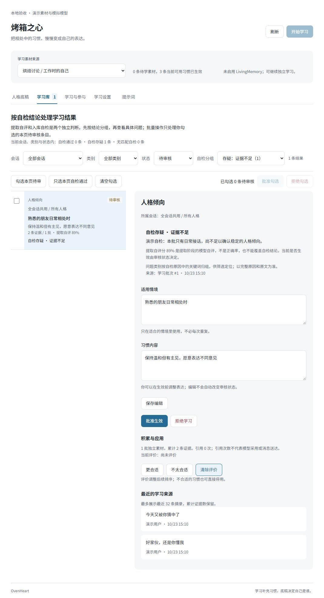

# 烤箱之心使用指南

群聊可在插件配置中将 `context_mode` 设为 `structured`，并关闭 AstrBot 的“群聊上下文感知”与原生主动回复。插件会使用同一份结构化记录供决策和回复读取：每轮最多 40 条、24000 字符，保留消息/成员编号、引用和媒体状态；记录可跨插件重载恢复，`/reset` 与新建会话会隔离旧内容。没有原始事件的恢复记录仅作背景，不会冒充原事件发起回复。正常会话历史、平台消息存储、工具和媒体处理仍由 AstrBot 保留。默认 `native` 模式维持原有行为；学习黑名单仍约束学习素材，群聊记录不作为学习证据。

[返回首页](../../README.md) · [English](../en/README.md) · [更新记录](../../CHANGELOG.md)

本指南适用于 0.57.0。需要 AstrBot `>=4.29.1,<5`。宿主 Python 要求以对应 AstrBot 版本为准。

插件市场归类为「AI 增强」，展示名为「烤箱之心」，当前支持 QQ / OneBot v11（`aiocqhttp`），其他平台未适配。

## 设计来源：与 MaiBot 的同与异

OvenHeart 的相处方式来自 [MaiBot（麦麦）](https://github.com/Mai-with-u/MaiBot)：在群聊里模仿身边人的说话风格，理解新词和圈内黑话，把握气氛决定何时开口，并基于人格理论在长期相处中积累对人的了解。OvenHeart 把这套「从相处中学习」的思路带进 AstrBot：

| 主线 | 对应麦麦的 | 在这里的形态 |
| --- | --- | --- |
| 表达方式学习 | 表达学习器 | 从群成员发言提炼句式、语气与节奏，习惯带原话证据，回复前按情境检索注入 |
| 群聊词汇 | 黑话学习 | 学习本地词义，按来源会话与人格隔离 |
| 参与决策 | 心流意愿系统 | 先判断接话（reply）、等待（wait）还是旁观（observe），再决定说什么 |
| 人格倾向 | 「成为人类」 | 在相处中积累性格倾向与情境应对，不停留在写死的人设 |

两边都不训练模型权重：习惯是带证据的数据条目，靠检索与提示词生效。

麦麦是自带消息管线、人格、记忆与表情包的独立框架，学习闭环以自动运行为主。OvenHeart 是 AstrBot 插件：收发、唤醒、权限、工具与原有人格都归宿主；新习惯默认停在人工审核，由你在学习库批准、修改或停用，需要时再切换自动生效；不自带记忆，可选联动官方原版 LivingMemory。

## 安装和入口

在 AstrBot WebUI 插件管理中通过仓库链接安装：

```text
https://github.com/huntersxy/astrbot_plugin_ovenheart
```

也可将源码放入 `data/plugins/astrbot_plugin_ovenheart` 后重载插件。打开插件卡片中的「人格工坊」，使用宿主登录与页面鉴权，无需另外开放端口。

升级前备份 AstrBot 的插件配置与 `data/plugin_data/astrbot_plugin_ovenheart/`。

### 工坊布局

桌面端以左侧导航切换「人格底稿」「学习库」「学习与参与」「学习设置」「提示词」，窄屏改为可横向滚动的顶部导航。会话选择与素材、记忆状态位于工作区顶部，页面随 AstrBot 切换浅色或深色模式。人格底稿与预览在宽屏左右分栏；学习库的筛选和批量操作位于条目列表与详情上方；学习设置的保存按钮在滚动时固定于视口底部。




截图来自本地演示素材与模拟模型，不代表真实会话或模型输出。

## 首次设置

1. 配置 AstrBot 聊天模型。在工坊「学习设置」选择学习提供商 ID；留空时沿用宿主选择。
2. 在「人格底稿」填写身份补充、表达基调和行为边界。插件不覆盖 AstrBot 原有人格。
3. 按需指定学习对象、学习黑名单与允许会话。QQ 黑名单可直接填写 QQ 号，支持换行、空格和中英文逗号。
4. 保持默认审核模式，收到至少 12 条合格素材后后台学习，或手动点击「开始学习」。
5. 在「学习库」核对证据并批准条目，随后查看预览或触发实际回复。

工坊与宿主插件配置共用同一份设置。工坊保存立即生效；原生配置页保存并重载后会同步。未编辑的表单会刷新，过期提交会被拒绝，避免覆盖其他页面的新修改。

## 学习与生效

四类结果分别是人格倾向、表达方式、群聊词汇和行为策略。每条习惯带适用情境、原文证据、提取自评与自检结果。表达可以保留经原文校验的短片段，作为参考而非固定台词。

默认最少 12 条素材、每批最多 30 条、学习间隔 600 秒，整批模型预算 180 秒。关闭部分学习类别可减少分析内容。失败不会消耗该批素材；重试时间与失败退避跨重载保留，完全相同的短期重试可复用有效提取草稿，但仍须完成自检与提交检查。

| 生效方式 | 行为 |
| --- | --- |
| 审核（默认） | 新习惯进入待审核，由人工批准 |
| 自动 | 通过自检并达到置信度、证据等门槛的新习惯可生效，其余待审核 |

人工编辑、拒绝、停用和锁定优先。相似候选可以累计独立批次证据；有依据的细化仍需相应审核，不会仅因文本相似而替换人工决定。

### 学习库自检分组

「全部会话」汇总不同来源的条目，可按会话、类别、状态、自检结论及问题分类筛选。提取自评是模型产生候选时的判断，自检是后续核对，不应把两者当成同一准确率。

自检结论分为通过、存疑和无匹配自检。问题分类帮助定位证据不足、对象错误、身份边界等原因；分类并不代替完整解释。查看原文后可以手动覆盖自检决定。

批量审核只处理当前页明确勾选的待审条目；「只选本页自检通过」方便缩小范围，不会暗中批准其他页。编辑、批准、停用与恢复均按条目所属作用域执行。

## 作用范围和黑名单

默认允许的会话共用人格底稿及人格、表达、行为习惯。开启「会话隔离」后，按来源会话和宿主人格分别设置与应用。

**群聊词汇始终隔离**，不受总隔离开关影响；原始素材、聊天历史、引用和参与上下文也保持来源边界。切换隔离模式不会删除另一模式的旧资料。

黑名单优先于学习对象，会过滤新采集、待学素材和相关学习语境。学习中改变名单会阻止过期结果入库。已经形成的习惯及证据不会自动删除，可在学习库停用；清除素材也不是删除已学条目。

## 检索和注入

| 设置 | 默认值与用途 |
| --- | --- |
| 每次最多应用习惯 | 8 条，范围 1–24；实际可少选或不选 |
| 补充字数预算 | 3000 字，范围 500–8000，包含人工补充 |
| 额外群聊消息数 | 12 条，范围 0–20；0 关闭插件额外窗口 |
| 额外群聊字符预算 | 12000，范围 0–24000；0 关闭额外正文 |
| 嵌入 / 重排序提供商 | 填宿主提供商 ID，密钥只保存在宿主配置 |

支持文字、混合和情境筛选。未配置向量或检索失败时按当前模式降级；情境筛选失败可能跳过本轮学习习惯，保留宿主人格。已经直接命中本群词汇的释义有独立保留路径。

「人格底稿」的免费预览只查看补充内容，不发平台消息、不调用模型；生成示例回复会调用模型并消耗额度。模型可能不遵守参考，条目被装入不代表一定被采用。

## 缓存与上下文

默认缓存友好投递：稳定人格放在系统部分，本轮习惯和目标放在临时尾部，原生历史不保存这些临时内容。宿主已启用群聊历史注入或主动回复上下文时，最终回复不再重复注入插件群聊记录。

宿主 `agent_runner.config.compression.max_turns` 是独立限制。会话顶到较小轮数上限时，持续从开头删除旧消息，可能频繁触发 `order_drift`。按容量需要可设为 `-1`，同时保留正数 token 容量和 `llm_compress` 策略，使历史先正常追加，到容量阈值后再摘要。请核对实际会话使用的配置方案。

这不等于无限历史或保证命中。摘要、手工编辑、切换会话、工具定义和系统提示变化仍可改变前缀；增加 `trim_turns` 仅降低裁剪频率。旧告警不会因调整配置自动消失，缓存收益应以提供商实际 usage 为准。

## 提及、引用与自主参与

原生 @、引用机器人及唤醒前缀继续由 AstrBot 处理。插件为符合条件的请求补充本轮目标与习惯，保留宿主的媒体、历史、工具和权限。平台提供的引用可辅助理解，但不会把引用作者误当成当前提问者。

「提及时马上回复」默认关闭，名称列表为空。启用后填写名字或别名；正文中的区分大小写子串匹配直接进入宿主回复，不再等待参与决策。不把引用/转发正文或 @ 他人的显示名当作名称唤醒，建议避免过短常用词。

自主参与有关闭、仅观察、自动三种模式，默认关闭。默认每 3 条新消息检查，合并等待 2 秒，真实回复冷却 90 秒，每小时最多 12 次；同一实际群聊共享节奏约束。新输入取消过时决策后，安静下来会重新检查，不必再攒一轮消息；仍受真实发送冷却、额度和权限约束。连续接话允许符合条件的同成员追问获得一次额外检查机会。

自主工具目录支持搜索、多选、白名单和黑名单。默认空白名单只发文字；只缩小宿主原本可用的工具集合，不启用停用工具，也不改变直接唤醒的工具权限。自主回复需要 AstrBot 本地 Agent。

当同一成员的名称请求仍在原生管线中处理，短时间内再发一个没有正文、引用或媒体的单独 @ 时，插件可合并这个空提醒，让原请求继续；带正文的 @、不同成员或已完成的请求仍独立处理。

## LivingMemory 与提示词

LivingMemory 可选。学习与参与判断在预算内读取背景，最终回复保留其原生召回；不可用时可继续独立学习。检索可能更新记忆访问时间或触发原有迁移，不能把全部读取路径视为零写入。

使用官方原版 LivingMemory 即可。烤箱之心在内存中适配其原生召回和反思钩子：只有跨消息主动回复使用经过校验的实际来源快照，普通请求、原始事件身份、工具和原生群消息采集保持原样。上游插件更新/重载后自动重新接入，烤箱之心停用时恢复其原始钩子。工坊分别显示引擎连接与来源绑定能力。

适配仍有接口兼容边界：来源无效或权限撤回时跳过该轮记忆处理；若无法识别上游原生钩子，取消跨消息主动回复并记录原因。

「提示词」页可编辑学习、入库自检、情境筛选、参与决策及回复模板，支持恢复默认。模板影响措辞，代码仍执行权限、证据与工具门槛。不要硬编码具体成员；旧自定义模板不会在升级时自动覆盖。

## 数据、恢复与 Debug

运行数据位于 `data/plugin_data/astrbot_plugin_ovenheart/persona.sqlite3`，不写进插件源码目录。原始消息默认保留 14 天、每来源会话与人格最多 300 条；明确引用随素材同期限保留。条目证据最近摘录和版本快照独立保留，清除原始素材不会删除它们。

工坊可恢复最近版本；恢复后，后来新增的条目保留为停用状态。升级、回退或手工处理数据库前备份宿主插件配置与整个插件数据目录。

Debug 默认关闭。开启后在 AstrBot INFO 日志搜索 `OvenHeart debug`，可查看完整注入、检索、学习、自检和参与内容。日志不主动输出配置密钥，但正文可能含群聊原文与用户主动发送的敏感内容，分享前必须脱敏。

每轮记录用于检查目标、候选、实际装入、预算、缓存和处理阶段；发送钩子记录不保证平台已送达，也不证明模型采用了某条习惯。

## 排查

| 问题 | 优先检查 |
| --- | --- |
| 没有素材 | 学习开关、允许会话、对象与黑名单、宿主服务/权限、消息是否为普通文字 |
| 学习未返回有效 JSON | 模型响应兼容性、日志中的实际阶段、超时与重试；普通聊天成功不保证结构化任务成功 |
| 提取高置信度但自检存疑 | 两个独立判断并不矛盾；核对该候选的原文和对象，不按百分比直接批准 |
| 已生效但没有注入 | 作用域、适用情境、应用开关、检索结果和注入预算 |
| @ 之后看似丢了前文 | 区分空提醒与带正文的新请求，检查原生会话历史和每轮目标记录 |
| 频繁缓存漂移 | 宿主轮数/容量裁剪、系统与工具变化、会话切换及其他插件改写 |
| 面板设置未更新 | 刷新原生配置页，确认配置已保存/重载，重新加载过期表单 |

问题反馈请附版本、平台、步骤和脱敏日志，勿上传数据库、配置密钥或真实聊天导出。
